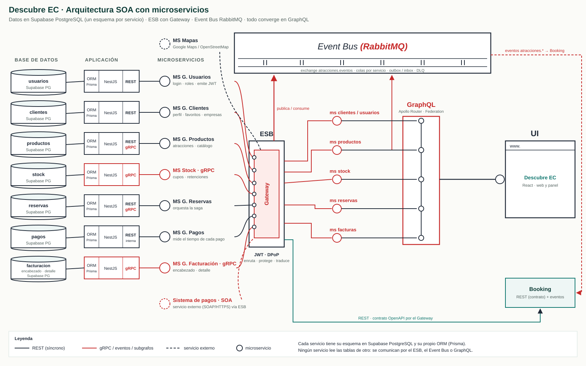
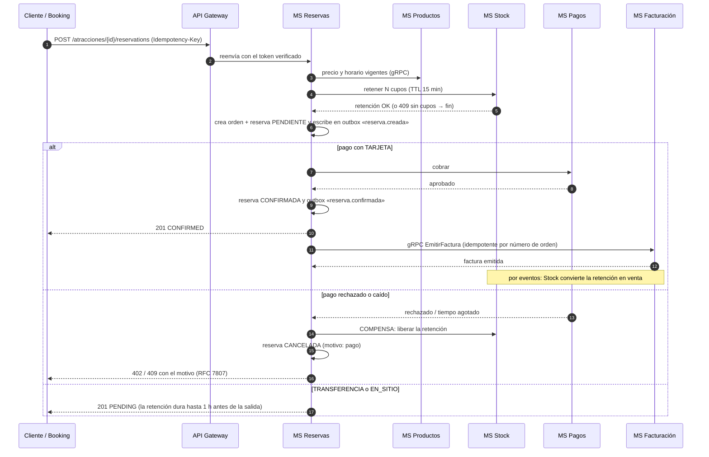
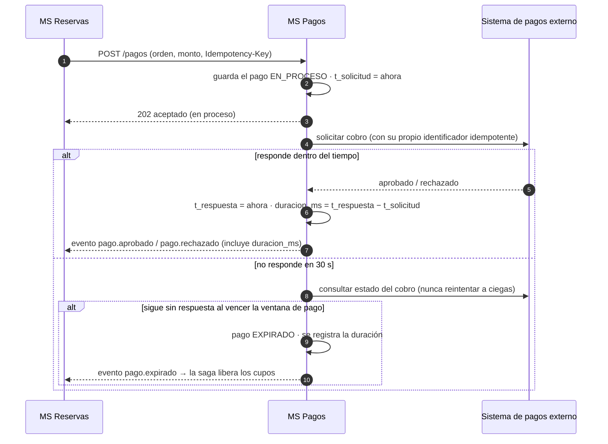
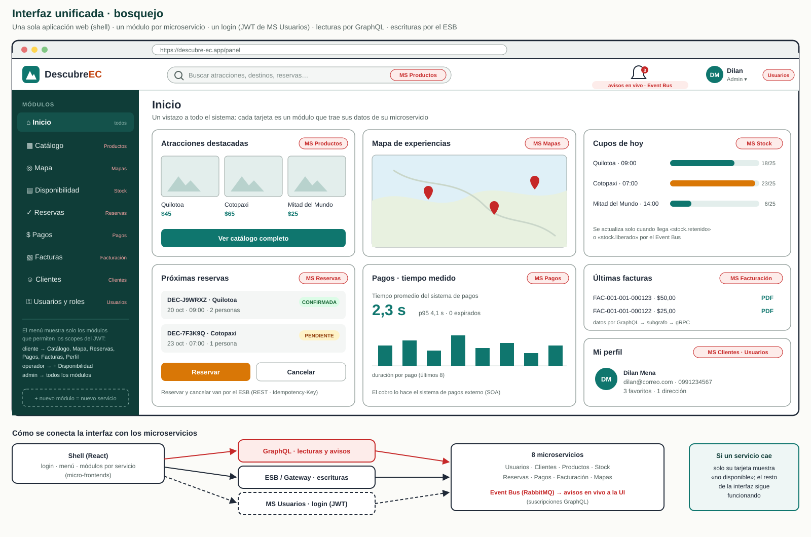

# Arquitectura de microservicios — Descubre EC

> **Estado de este documento (versión 3.0.0, noviembre de 2026).** Es el **diseño** de la arquitectura, escrito el
> 19 de octubre a partir de la pizarra de clase, antes de construir los microservicios. Varias piezas se implementaron
> de otra forma. La tabla siguiente indica qué está en el código y en producción; para lo implementado, ver
> [ARQUITECTURA.md](ARQUITECTURA.md) y [CATALOGO-RUTAS-MICROSERVICIOS.md](CATALOGO-RUTAS-MICROSERVICIOS.md).
>
> | Pieza del diseño | Implementación real | Estado |
> |---|---|---|
> | Gateway del ESB | API Gateway propio en NestJS (`microservicios/gateway`); el JWT y los permisos los valida cada servicio | Implementado, con cambios |
> | Event Bus RabbitMQ | Outbox + CloudEvents por REST: cada servicio guarda el evento en su tabla `evento` y lo envía cada 3 s a `/api/v1/internal/eventos` del destino, con 20 reintentos | **No hay broker** |
> | Inbox y DLQ | Solo reintentos del outbox | Parcial |
> | Saga de compra | ms-booking coordina 7 servicios con compensaciones | Implementado |
> | GraphQL para la UI | BFF por REST (`microservicios/bff-web`, ruta `/bff/v1`) | **No implementado** |
> | OpenTelemetry, Jaeger, Prometheus, Grafana | `X-Correlation-Id` y Azure Log Analytics | **No implementado** |
> | Rate limiting en el gateway | Solo en el monolito (Throttler) | Pendiente |
> | Servicios (Usuarios, Clientes, Productos, Stock, Reservas, Pagos, Facturación) | 12 servicios: catalog, location, review, identity, pricing, inventory, order, booking, payment, refund, coupon, invoicing | Implementado, con otra división |
> | Pagos por SOAP y facturación por gRPC | Pagos por REST (ms-payment) y facturación por SOAP (ms-invoicing) | Implementado al revés |

Especificación para pasar el sistema actual (un backend NestJS monolítico modular) a una arquitectura **SOA con microservicios**, integrable con el marketplace Booking. Toma como base el diagrama de la pizarra de clase y los contratos que ya existen en `backend/contracts/`.

**Contenido:**
- Lectura de la pizarra (0), **diagrama** y cómo convergen **ESB, Event Bus (RabbitMQ) y GraphQL** (1).
- Microservicios, **qué interfaz expone cada uno (REST, GraphQL, gRPC, eventos)** y **SOA** (2).
- Dueño de cada tabla, tablas por tipo de comunicación y **datos en Supabase PostgreSQL** (3), y contratos REST (4).
- Bus de eventos / ESB (5) y saga de compra, con **pagos externos medidos** y **facturación gRPC** (6).
- GraphQL / CQRS y la **interfaz unificada** que da acceso a todos los microservicios, con su bosquejo (7).
- Seguridad (8), observabilidad (9) y resiliencia (10).
- Estructura del repositorio (11) y plan de migración (12).
- Pruebas (13), acuerdos con Booking (14), checklist (15) y riesgos (16).

> **Regla de oro de la migración:** todo lo que hoy se promete a Booking (contrato OpenAPI, eventos AsyncAPI, esquema GraphQL, proto) se mantiene **sin romperse**. Los microservicios se esconden detrás del gateway: para quien integra, la API sigue siendo la misma.

---

## 0. Lectura de la pizarra

| En la pizarra | En Descubre EC |
|---|---|
| Modelo: `Usuario`, `Rol`, `Cliente` | Identidad: usuario, rol, usuario_rol, sesión |
| Modelo: `Productos` | Catálogo: atracciones, categorías, destinos, fotos, tarifas |
| Modelo: `Encabezado` + `Detalle` | Orden de compra / factura (cabecera y líneas) |
| Base de datos **MySQL** → Aplicación (ORM + API REST) → **MS G. Clientes** | MS Clientes con su propio esquema `clientes` en **PostgreSQL (Supabase)** |
| Base de datos **PostgreSQL** → Aplicación (ORM + API REST) → **MS G. Productos**, **MS G. Pagos** | MS Productos y MS Pagos, cada uno con su esquema en **PostgreSQL (Supabase)**. Los pagos los procesa un **sistema de pagos externo** y se mide el tiempo de cada uno (sección 6.1) |
| Base de datos **SQL Server** (`Encabezado` / `Detalle`) → Aplicación (ORM + API REST) → **MS G. Facturación** | **MS Facturación como microservicio gRPC**, con su esquema `facturacion` en **PostgreSQL (Supabase)** |
| **MS Google Maps** | MS Mapas: adaptador a un proveedor de mapas externo |
| **ESB** con **Gateway** | Bus de integración: API Gateway (entrada síncrona) + broker de eventos (asíncrono) |
| Lado derecho: ms clientes, ms productos, MS G facturas, **MS Stock** → **GraphQL** → **UI www** | Subgrafos GraphQL de cada servicio unidos por un gateway GraphQL (Federation) que consume la web: **todo converge en GraphQL** |
| **MS G. Usuarios** (separado de Clientes) | **MS Usuarios**: cuentas, roles, sesiones y emisión del JWT; MS Clientes queda con los datos del cliente |
| **Event Bus (RabbitMQ)** sobre todo el sistema | El bus de eventos asíncrono: *exchange* `atracciones.eventos` en **RabbitMQ**, conectado al ESB (sección 5) |
| **MS Stock** con **gRPC** | MS Stock expone gRPC (`GetDisponibilidad`) además de su REST pública |
| Servicio **SOA** abajo a la izquierda | El **sistema de pagos externo**, integrado al estilo SOA a través del ESB (SOAP/HTTPS, sección 6.1) |
| **JWT** | El Gateway del ESB valida el JWT (emitido por MS Usuarios) antes de dejar pasar cualquier petición |

Cada microservicio tiene **sus propios datos**. El ORM y su API (REST o gRPC) viven dentro de cada servicio, y la UI solo habla con GraphQL.

> **Decisión del proyecto: un solo motor, PostgreSQL en Supabase.** La pizarra muestra varios motores (MySQL, PostgreSQL, SQL Server) para ilustrar que cada servicio puede elegir el suyo. En Descubre EC **todos los servicios usan PostgreSQL en Supabase**, porque es donde ya vive la base actual: la migración es más simple y hay un solo motor que operar y respaldar. El principio de «una base por servicio» se mantiene con **un esquema y un usuario por servicio** (sección 3.2): ningún servicio puede leer ni escribir las tablas de otro.

> Interpretamos la sigla «CRG» de la consigna como **CQRS** (separar escrituras y lecturas): las escrituras entran por REST/ESB y las lecturas de la UI salen por GraphQL. Si el profesor se refería a otra cosa, esta es la sección que hay que ajustar.

---

## 1. Vista general



*Diagrama según la pizarra de clase. De izquierda a derecha:*
1. *Cada **base de datos** (un esquema en Supabase PostgreSQL) alimenta su **aplicación**: ORM Prisma + NestJS + API REST o gRPC.*
2. *Cada aplicación se publica como **microservicio**.*
3. *Todos se conectan al **ESB** a través de su **Gateway**, que valida el JWT.*
4. *El ESB publica y consume en el **Event Bus (RabbitMQ)**.*
5. *Los servicios exponen sus **subgrafos**, que **convergen en GraphQL**.*
6. *GraphQL entrega todo a la **UI**. Booking se integra por REST (contrato OpenAPI) y por los eventos.*

### 1.1 Event Bus, ESB y GraphQL: cómo convergen

| Pieza | Qué es | Qué hace en Descubre EC |
|---|---|---|
| **ESB** (*Enterprise Service Bus*) | La columna de integración de la arquitectura SOA | Recibe **todas** las peticiones síncronas a través de su **Gateway**. Valida el **JWT** (y DPoP), aplica el límite de peticiones y enruta al microservicio correcto. Traduce protocolos (REST ↔ gRPC, y SOAP/HTTPS hacia el **sistema de pagos externo**, que es el servicio **SOA** de la pizarra). Publica en el Event Bus lo que entra por él. |
| **Event Bus (RabbitMQ)** | El bus de eventos asíncrono | Un *exchange* de tipo `topic` llamado `atracciones.eventos`. Cada servicio publica sus eventos (`reserva.confirmada`, `pago.aprobado`…) y cada interesado, incluido **Booking**, tiene su propia cola. Nadie espera a nadie: si un servicio está caído, sus mensajes lo esperan en su cola. |
| **GraphQL** (Apollo Router · Federation) | El punto donde **todo converge** para leer | Cada microservicio (Usuarios/Clientes, Productos, Stock, Reservas, Facturas) publica un **subgrafo**. El router los une en un único esquema, y la UI hace **una sola consulta** para traer datos de varios servicios a la vez. |

**Cómo se reparten el trabajo:**
- **Escrituras** (crear, reservar, pagar, cancelar): UI o Booking → **ESB/Gateway** → microservicio → evento en el **Event Bus**.
- **Lecturas** de la UI: UI → **GraphQL** → subgrafos de los microservicios.
- **Avisos entre servicios y a Booking:** **Event Bus** (RabbitMQ).

**Por qué todo converge en GraphQL:** la UI no conoce a los 8 microservicios ni sus direcciones. Solo conoce **un punto de entrada** (`/graphql`). Si mañana un servicio se divide o cambia de lugar, la UI no se entera: el router se encarga de buscar cada dato donde está.

**Dos caminos de comunicación:**

| Camino | Para qué | Tecnología |
|---|---|---|
| **Síncrono** (petición y respuesta) | Consultas y comandos que necesitan respuesta inmediata | REST (contrato OpenAPI) por el API Gateway; gRPC entre servicios cuando haga falta |
| **Asíncrono** (eventos) | Avisar que algo pasó, sin esperar respuesta: reserva creada, pago aprobado… | **Event Bus RabbitMQ** con el contrato AsyncAPI |

---

## 2. Catálogo de microservicios

Son **8 servicios**. Cada uno es **dueño exclusivo** de sus tablas: ningún otro servicio las lee ni escribe directamente.

| Servicio | Responsabilidad | Base de datos | Puerto (desarrollo) |
|---|---|---|:-:|
| **MS Usuarios** | Cuentas, roles, sesiones, login (correo y Google); **emite los JWT** (es el servidor de identidad) | Supabase PostgreSQL · esquema `usuarios` | 3001 |
| **MS Clientes** | Datos del cliente: direcciones, favoritos, mensajes de contacto y empresas operadoras | Supabase PostgreSQL · esquema `clientes` | 3008 |
| **MS Productos** | Catálogo: atracciones, categorías, destinos, idiomas, fotos, tarifas, horarios, reseñas | Supabase PostgreSQL · esquema `productos` | 3002 |
| **MS Stock** | Inventario: cupos por fecha y horario, fechas bloqueadas, retenciones temporales | Supabase PostgreSQL · esquema `stock` | 3003 |
| **MS Reservas** | Orden, reserva y pasajeros; **orquesta la saga de compra** y aplica la política de cancelación | Supabase PostgreSQL · esquema `reservas` | 3004 |
| **MS Pagos** | Intermediario con el **sistema de pagos externo**: envía el cobro, **mide el tiempo** de cada pago, aplica tiempos máximos y registra reembolsos | Supabase PostgreSQL · esquema `pagos` | 3005 |
| **MS Facturación** | **Microservicio gRPC**: emite, consulta y anula facturas (encabezado y detalle) | Supabase PostgreSQL · esquema `facturacion` | 3006 (gRPC 50056) |
| **MS Mapas** | Adaptador a Google Maps / OpenStreetMap: buscar lugares, dirección a partir de coordenadas, límite de frecuencia y caché | — (Redis como caché) | 3007 |

Infraestructura compartida:

| Pieza | Tecnología | Puerto (desarrollo) |
|---|---|:-:|
| API Gateway | Kong 3 (o NGINX) | 8000 |
| Gateway GraphQL | Apollo Router (Federation 2) | 4000 |
| **Event Bus** | **RabbitMQ 3.13** (colas *quorum*, *publisher confirms*) | 5672 · panel 15672 |
| Validación de eventos | AsyncAPI + JSON Schema, validados en el CI y al publicar (RabbitMQ no trae registro de esquemas) | — |
| Caché | Redis 7 | 6379 |
| Observabilidad | OpenTelemetry + Jaeger (trazas), Prometheus + Grafana (métricas) | 16686 / 3000 |

### 2.1 Pila común de cada servicio

| Capa | Elección | Por qué |
|---|---|---|
| Framework | **NestJS 11** (TypeScript) | Es el del sistema actual: se reutiliza el código de los módulos |
| ORM | **Prisma** (proveedor `postgresql`, con `multiSchema`) sobre **Supabase PostgreSQL** | Cada servicio declara solo su esquema. Se conecta por el *pooler* de Supabase en ejecución (`DATABASE_URL`, puerto 6543) y por conexión directa para las migraciones (`DIRECT_URL`, puerto 5432) |
| API REST | Controladores Nest + DTO con `class-validator` | Igual que hoy |
| GraphQL | `@nestjs/graphql` + `@apollo/subgraph` | Cada servicio publica su subgrafo |
| Eventos | `@nestjs/microservices` (transporte RMQ) / `amqplib` + patrón *outbox* | Ver la sección 5 |
| Errores | RFC 7807 (Problem Details) | Igual que hoy, mismo catálogo `/errores/{tipo}` |
| Salud | `GET /health/live` y `GET /health/ready` | Para el orquestador y el gateway |

### 2.1.1 Qué interfaz expone cada servicio (REST, GraphQL, gRPC, eventos)

Todos los servicios tienen **API REST** (es su interfaz base, como en la pizarra). Lo que cambia es quién puede llamarla:
- **REST pública:** sale por el API Gateway y es parte del contrato con Booking y con la web.
- **REST interna:** solo la llaman otros servicios dentro de la red privada; no se publica en el gateway.

| Servicio | REST pública (gateway) | REST interna | GraphQL (subgrafo para la UI) | gRPC (interno) | Eventos |
|---|:-:|:-:|:-:|:-:|:-:|
| **MS Usuarios** | ✅ login, registro, Google, `/auth/me`, usuarios y roles | ✅ JWKS (`/.well-known/jwks.json`) para que los servicios verifiquen el JWT | ✅ `Usuario` | — | Publica |
| **MS Clientes** | ✅ perfil de cliente, direcciones, favoritos, contacto, operadores y empresas | ✅ datos de contacto para Reservas y Facturación | ✅ `Cliente`, `Operador` | — | Publica |
| **MS Productos** | ✅ **contrato Booking**: listar, buscar, detalle, CRUD de atracciones, catálogos, reseñas | — | ✅ `Atraccion`, `Ciudad`, `Categoria`, `Resena` | ✅ `GetAtraccion`, `BatchGetAtracciones` (precio y horario para Reservas) | Publica |
| **MS Stock** | ✅ **contrato Booking**: disponibilidad, calendario, fechas bloqueadas | ✅ `POST /retenciones`, `DELETE /retenciones/{id}` (solo Reservas) | ✅ `Disponibilidad` | ✅ `GetDisponibilidad` | Publica y consume |
| **MS Reservas** | ✅ **contrato Booking**: reservar, consultar, cancelar, confirmar, calendario | — | ✅ `Reserva` | ✅ `CrearReserva`, `CancelarReserva` (para Booking si prefiere gRPC) | Publica y consume |
| **MS Pagos** | ❌ **no es público** | ✅ `POST /pagos`, `POST /pagos/{n}/reembolso` (solo Reservas); `POST /webhooks/pasarela` (respuesta del sistema de pagos externo) | ❌ (datos sensibles) | — | Publica y consume |
| **MS Facturación** | ✅ solo lectura, **traducida por el gateway a gRPC** (`GET /facturas/{n}` → `ObtenerFactura`) | — | ✅ `Factura` (el subgrafo llama al servicio por gRPC) | ✅ **interfaz principal**: `EmitirFactura`, `ObtenerFactura`, `AnularFactura`, `ListarFacturasDeCliente` | Publica `factura.emitida` |
| **MS Mapas** | ✅ `GET /mapas/buscar`, `GET /mapas/inversa` (para el panel de empresas) | ✅ validar dirección o coordenadas (para Productos) | ❌ (utilidad, no es un dato del negocio) | — | — |

**Resumen:**
- **Siguen como REST hacia Booking** (el contrato actual, sin cambios): **Productos, Stock y Reservas**, más **Usuarios** para la autenticación (JWT).
- **REST solo interno:** **Pagos**. Nadie de fuera cobra directamente: siempre pasa por Reservas, que controla la saga.
- **REST pero no GraphQL:** **Pagos** y **Mapas**.
- **GraphQL** (lectura para la web; aquí **converge todo**): Usuarios, Clientes, Productos, Stock, Reservas y Facturación.
- **gRPC** (llamadas internas rápidas): Productos, Stock y Reservas, según `atracciones.proto`, y **Facturación, que es un microservicio gRPC** (`facturacion.proto`, sección 6.2).
- **Sistema de pagos externo:** MS Pagos lo llama por HTTPS y mide el tiempo de cada pago (sección 6.1).

¿Por qué no todo en GraphQL? GraphQL es para **leer** combinando datos en la UI. Las **escrituras** críticas (reservar, cancelar, cobrar) van por REST, porque tienen Idempotency-Key, códigos HTTP claros (201, 409, 402) y el contrato que Booking ya integra.

### 2.2 Orientación a servicios (SOA)

La arquitectura es **SOA implementada con microservicios**:
- **De SOA** toma el **ESB** como columna de integración, los **contratos formales** de cada servicio, la **composición** de servicios en procesos de negocio y la **gobernanza** centralizada.
- **De los microservicios** toma que cada servicio sea pequeño, tenga **su propia base de datos** y se despliegue de forma independiente.

#### Principios SOA y cómo se cumplen

| Principio SOA | Cómo se cumple en Descubre EC |
|---|---|
| **Contrato estandarizado** | Cada servicio publica su contrato antes de programarse (API-First): OpenAPI para REST, AsyncAPI para eventos, SDL para GraphQL y `.proto` para gRPC. El contrato público para Booking es el de `contracts/` y no cambia. |
| **Bajo acoplamiento** | Ningún servicio accede a la base de datos de otro. Solo se comunican por su contrato (REST/gRPC) o por eventos en el bus. |
| **Abstracción** | El contrato no expone tablas, esquemas ni el motor: Booking no sabe que los datos viven en Supabase ni cuál es el sistema de pagos. Solo ve UUID, JSON y errores RFC 7807. |
| **Reutilización** | Un mismo servicio sirve a varios consumidores: Productos atiende a la web (GraphQL), a Booking (REST) y a Reservas (gRPC). Mapas lo usa cualquier servicio que necesite geografía. |
| **Autonomía** | Cada servicio controla su base de datos, su despliegue y su escalado. Si Facturación cae, se sigue vendiendo (la factura llega después por eventos). |
| **Sin estado** (*statelessness*) | Ningún servicio guarda la sesión en memoria: el token JWT viaja en cada petición y el estado vive en la base de datos o en Redis. Se puede agregar réplicas sin coordinarlas. |
| **Descubrimiento** | **Registro de servicios**: catálogo con cada servicio, su contrato, su versión y su dueño (ver más abajo). Internamente, descubrimiento por DNS de Docker/Kubernetes y comprobación con `/health/ready`. |
| **Composición** | Los procesos de negocio se arman combinando servicios. Por ejemplo, «comprar una experiencia» = Productos + Stock + Reservas + Pagos + Facturación (sección 6). |

#### Clasificación de los servicios (capas de SOA)

| Capa SOA | Qué contiene | Servicios de Descubre EC |
|---|---|---|
| **Servicios de proceso** (*task / process*) | Coordinan un proceso de negocio completo usando otros servicios | **MS Reservas**: orquesta la compra y la cancelación |
| **Servicios de entidad** (*entity*) | Administran un concepto del negocio y sus datos | **MS Usuarios**, **MS Clientes**, **MS Productos**, **MS Stock**, **MS Pagos**, **MS Facturación** |
| **Servicio SOA externo** | Sistema de otra organización integrado a través del ESB | **Sistema de pagos** (SOAP/HTTPS): el ESB traduce y protege la comunicación (sección 6.1) |
| **Servicios de utilidad** (*utility*) | Capacidades técnicas transversales, sin lógica del negocio | **MS Mapas** (geografía), notificaciones (correo, futuro), y en `paquetes/comun` el log, la auditoría y la verificación de tokens |
| **Capa de integración** (ESB) | Conecta, transforma, enruta y protege | **API Gateway** + **broker de eventos** (sección 5) |
| **Capa de presentación** | Consume los servicios | Web (por GraphQL) y Booking (por REST y eventos) |

#### Qué hace el ESB

El ESB de la pizarra se reparte en dos piezas especializadas, en lugar de un único producto pesado:

| Función clásica de un ESB | Pieza que la cumple |
|---|---|
| **Enrutamiento** (enviar cada petición al servicio correcto) | API Gateway: `/api/v1/atracciones/{id}/reservations` → MS Reservas |
| **Transformación** de formatos y protocolos | Gateway (REST ↔ gRPC cuando haga falta) y router GraphQL (une las respuestas de varios servicios) |
| **Mediación de seguridad** | Gateway: verifica el token JWT y DPoP, los scopes, CORS y el límite de peticiones antes de llegar al servicio |
| **Mensajería asíncrona** (publicar y suscribir) | **Event Bus RabbitMQ**: *exchange* `atracciones.eventos` con una cola por servicio consumidor |
| **Entrega garantizada** | Outbox e inbox, reintentos y DLQ (sección 5.3) |
| **Orquestación** | MS Reservas: saga de compra (sección 6) |
| **Coreografía** | Eventos: Stock, Facturación y Booking reaccionan a `reserva.confirmada` sin que nadie se lo ordene |
| **Monitoreo** | OpenTelemetry, Jaeger, Prometheus y Grafana (sección 9) |

Se evita el antipatrón de un ESB «inteligente» que acumula lógica del negocio: **las reglas viven en los servicios** (*smart endpoints, dumb pipes*). El ESB solo enruta, protege y transporta.

#### Orquestación y coreografía

| Estilo | Cuándo se usa | Ejemplo |
|---|---|---|
| **Orquestación** (un servicio dirige los pasos) | Procesos donde el orden importa y hay que deshacer si algo falla | Compra: Reservas llama a Stock, luego a Pagos, y compensa si el pago falla |
| **Coreografía** (cada servicio reacciona a eventos) | Consecuencias independientes de un hecho | Al publicarse `reserva.confirmada`: Stock marca los cupos como vendidos, Facturación emite la factura y Booking actualiza su vista, cada uno por su cuenta |

#### Registro y gobernanza de servicios

Archivo `servicios/catalogo.yaml`, revisado en cada PR:

```yaml
- servicio: ms-reservas
  capa: proceso
  dueno: equipo-reservas
  version: 1.4.0
  contratos:
    rest: servicios/reservas/contracts/openapi.yaml
    eventos_publica: [atracciones.reserva.creada, atracciones.reserva.confirmada, atracciones.reserva.cancelada]
    eventos_consume: [atracciones.pago.aprobado, atracciones.pago.rechazado, atracciones.stock.liberado]
    graphql: servicios/reservas/contracts/subgraph.graphql
  depende_de: [ms-productos, ms-stock, ms-pagos]
  sla: { disponibilidad: 99.5, p95_ms: 2000 }
```

Reglas de gobernanza:
- **Ningún servicio se publica sin su contrato** (lo verifica el CI).
- Los cambios que rompen un contrato necesitan una versión mayor y un aviso a los consumidores.
- Cada evento y cada contrato tiene un dueño responsable.
- El catálogo genera la página de documentación de servicios para los equipos de Booking.

---

## 3. Dueño de cada tabla

Las tablas salen de `database/01_esquema.sql` y sus migraciones. Entre servicios **no hay claves foráneas**: se guarda el identificador público (UUID o código) y la consistencia se mantiene con eventos.

| Servicio | Tablas que posee | Referencias externas que guarda (solo el id) |
|---|---|---|
| MS Usuarios (esquema `usuarios`) | `usuario`, `rol`, `usuario_rol`, `sesion`, `token_verificacion` | — |
| MS Clientes (esquema `clientes`) | `direccion`, `operador`, `operador_usuario`, `solicitud_operador`, `favorito`, `mensaje_contacto` | `usu_id` (Usuarios) |
| MS Productos (esquema `productos`) | `region`, `provincia`, `ciudad`, `categoria`, `idioma`, `inclusion`, `atraccion`, `atraccion_categoria`, `atraccion_idioma`, `atraccion_inclusion`, `atraccion_foto`, `horario`, `tarifa`, `resena` | `atraccion.ope_codigo` (Clientes), `resena.usu_id` y `res_uuid` (Clientes y Reservas) |
| MS Stock (esquema `stock`) | `disponibilidad`, `fecha_bloqueada`, **`retencion`** (nueva: cupos apartados con vencimiento) | `atr_uuid`, `hor_id` (Productos) |
| MS Reservas (esquema `reservas`) | `orden`, `orden_detalle`, `reserva`, `reserva_pasajero`, `estado`, `idempotencia`, `cupon`, `orden_cupon`, `carrito`, `carrito_item` | `usu_id` (Usuarios), `atr_uuid` (Productos), `retencion_id` (Stock), `pag_numero` (Pagos) |
| MS Pagos (esquema `pagos`) | `metodo_pago`, `pago`, `pago_tarjeta`, `pago_transferencia`, `reembolso` | `ord_numero` (Reservas) |
| MS Facturación (esquema `facturacion`) | `factura` (**encabezado**), **`factura_detalle`** (líneas; ya existe desde la migración 007) | `ord_numero` (Reservas), `pag_numero` (Pagos), datos del cliente copiados al facturar |
| Cada servicio | `outbox` (eventos por publicar), `inbox` (eventos ya procesados), `bitacora` (auditoría propia) | — |

**Datos copiados a propósito.** Facturación copia el nombre, la cédula y la dirección del cliente al emitir la factura. Una factura no puede cambiar si el cliente edita su perfil después, y así no depende de Clientes para imprimirse.

### 3.1 Las 45 tablas: a qué microservicio van y cómo se comunican

Cómo leer las columnas:
- **REST pública:** se expone por el API Gateway a Booking o a la web.
- **REST interna:** solo la usan otros servicios dentro de la red privada.
- **gRPC:** llamada interna rápida entre servicios (`atracciones.proto`).
- **SOA (ESB):** los cambios de esa tabla se **publican como eventos** en el bus, o la tabla se actualiza **al consumir** eventos de otro servicio.

#### MS Usuarios — esquema `usuarios`

| Tabla | REST pública | REST interna | gRPC | SOA (ESB) |
|---|:-:|:-:|:-:|---|
| `usuario` | ✅ (registro, perfil, usuarios) | ✅ (JWKS) | — | Publica `usuario.registrado` / `usuario.actualizado` |
| `rol` | ✅ (admin) | — | — | — |
| `usuario_rol` | ✅ (admin) | — | — | Publica `usuario.actualizado` (cambio de rol) |
| `sesion` | ✅ (login, logout) | — | — | — |
| `token_verificacion` | ✅ | — | — | — |

#### MS Clientes — esquema `clientes`

| Tabla | REST pública | REST interna | gRPC | SOA (ESB) |
|---|:-:|:-:|:-:|---|
| `direccion` | ✅ | ✅ (para Facturación) | — | Publica `cliente.actualizado`; consume `usuario.registrado` (crea la ficha del cliente) |
| `operador` | ✅ (operadores) | — | — | Publica `operador.aprobado` |
| `operador_usuario` | ✅ | — | — | Publica `operador.aprobado` |
| `solicitud_operador` | ✅ (empresas) | — | — | Publica `operador.aprobado` |
| `favorito` | ✅ | — | — | — |
| `mensaje_contacto` | ✅ (contacto) | — | — | — |

#### MS Productos — esquema `productos`

| Tabla | REST pública | REST interna | gRPC | SOA (ESB) |
|---|:-:|:-:|:-:|---|
| `region` | ✅ | — | — | — |
| `provincia` | ✅ | — | — | — |
| `ciudad` | ✅ (destinos) | — | — | — |
| `categoria` | ✅ | — | — | — |
| `idioma` | ✅ | — | — | — |
| `inclusion` | ✅ | — | — | — |
| `atraccion` | ✅ (**contrato Booking**) | — | ✅ `GetAtraccion`, `BatchGetAtracciones` | Publica `atraccion.publicada` / `.actualizada` / `.retirada`; consume `operador.aprobado` |
| `atraccion_categoria` | ✅ | — | ✅ (dentro de la atracción) | — |
| `atraccion_idioma` | ✅ | — | ✅ (dentro de la atracción) | — |
| `atraccion_inclusion` | ✅ | — | ✅ (dentro de la atracción) | — |
| `atraccion_foto` | ✅ | — | ✅ (dentro de la atracción) | — |
| `horario` | ✅ | — | ✅ (horarios para reservar) | Publica `atraccion.actualizada` (Stock ajusta los cupos) |
| `tarifa` | ✅ | — | ✅ (precio vigente para reservar) | Publica `atraccion.actualizada` |
| `resena` | ✅ | — | — | — |

#### MS Stock — esquema `stock`

| Tabla | REST pública | REST interna | gRPC | SOA (ESB) |
|---|:-:|:-:|:-:|---|
| `disponibilidad` | ✅ (**contrato Booking**: disponibilidad, calendario) | — | ✅ `GetDisponibilidad` | Publica `stock.retenido` / `stock.liberado`; consume `atraccion.*` y `reserva.*` |
| `fecha_bloqueada` | ✅ (fechas bloqueadas) | — | — | Consume `atraccion.retirada` (cierra las fechas) |
| `retencion` *(nueva)* | — | ✅ (solo Reservas) | — | Publica `stock.retenido` / `stock.liberado` |

#### MS Reservas — esquema `reservas`

| Tabla | REST pública | REST interna | gRPC | SOA (ESB) |
|---|:-:|:-:|:-:|---|
| `reserva` | ✅ (**contrato Booking**: reservar, consultar, cancelar) | — | ✅ `CrearReserva`, `CancelarReserva` | Publica `reserva.creada` / `.confirmada` / `.cancelada`; consume `pago.*` y `stock.*` |
| `reserva_pasajero` | ✅ (dentro de la reserva) | — | ✅ (dentro de la reserva) | Va en los datos de `reserva.*` |
| `orden` | ✅ (dentro de la reserva) | — | ✅ (la crea `CrearReserva`) | Va en los datos de `reserva.*` |
| `orden_detalle` | ✅ (dentro de la reserva) | — | ✅ (la crea `CrearReserva`) | Va en los datos de `reserva.*` |
| `estado` | ✅ (catálogo) | — | — | — |
| `cupon` | ✅ | — | — | — |
| `orden_cupon` | ✅ | — | — | — |
| `carrito` | ✅ | — | — | — |
| `carrito_item` | ✅ | — | — | — |
| `idempotencia` | — (uso interno: cabecera `Idempotency-Key`) | — | — | — |

#### MS Pagos — esquema `pagos` (pagos procesados por un sistema externo)

| Tabla | REST pública | REST interna | gRPC | SOA (ESB) |
|---|:-:|:-:|:-:|---|
| `pago` | ❌ | ✅ (solo Reservas, más el *webhook* del sistema de pagos) | — | Publica `pago.aprobado` / `pago.rechazado` / `pago.expirado`. Guarda **los tiempos medidos** de cada pago (sección 6.1) |
| `pago_tarjeta` | ❌ | ✅ | — | — (los datos de tarjeta **nunca** viajan en eventos) |
| `pago_transferencia` | ❌ | ✅ | — | — |
| `reembolso` | ❌ | ✅ | — | Publica `pago.reembolsado`; consume `reserva.cancelada` |
| `metodo_pago` | ❌ | ✅ | — | — |

#### MS Facturación — esquema `facturacion` (microservicio gRPC)

| Tabla | REST pública | REST interna | gRPC | SOA (ESB) |
|---|:-:|:-:|:-:|---|
| `factura` (encabezado) | ✅ (solo lectura, vía gateway → gRPC) | — | ✅ `EmitirFactura`, `ObtenerFactura`, `AnularFactura` | Publica `factura.emitida` / `factura.anulada` |
| `factura_detalle` *(migración 007)* | ✅ (solo lectura, vía gateway → gRPC) | — | ✅ (dentro de la factura) | Va en los datos de `factura.emitida` |

#### Tablas técnicas presentes en cada servicio

| Tabla | Uso | Comunicación |
|---|---|---|
| `evento` (pasa a `outbox` en cada servicio) | Eventos pendientes de publicar | **SOA (ESB)**: el *relay* los publica en el Event Bus RabbitMQ |
| `inbox` *(nueva)* | Eventos ya procesados, para no repetirlos | **SOA (ESB)**: consumo idempotente |
| `bitacora` | Auditoría interna de cada servicio | Ninguna (uso interno) |

#### Resumen: las tablas agrupadas por tipo de comunicación

**Con gRPC (14 tablas):** las que se necesitan rápido y en tiempo real dentro de la compra, más la facturación, que es un microservicio gRPC.
- Productos: `atraccion`, `atraccion_categoria`, `atraccion_idioma`, `atraccion_inclusion`, `atraccion_foto`, `horario`, `tarifa`.
- Stock: `disponibilidad`.
- Reservas: `reserva`, `reserva_pasajero`, `orden`, `orden_detalle`.
- Facturación: `factura`, `factura_detalle`.

**Integradas por SOA a través del ESB y el Event Bus (20 tablas, más el outbox/inbox de cada servicio):** las que avisan a otros servicios, y a Booking, de que algo cambió.
- Usuarios: `usuario`, `usuario_rol`.
- Clientes: `direccion`, `operador`, `operador_usuario`, `solicitud_operador`.
- Productos: `atraccion`, `horario`, `tarifa`.
- Stock: `disponibilidad`, `fecha_bloqueada`, `retencion`.
- Reservas: `reserva`, `reserva_pasajero`, `orden`, `orden_detalle`.
- Pagos: `pago`, `reembolso`.
- Facturación: `factura`, `factura_detalle` (publica `factura.emitida` / `.anulada`).
- Técnicas: `evento` (outbox) e `inbox` en cada servicio.

**Se quedan solo con REST (23 tablas):** catálogos y datos que se consultan o editan directamente y no disparan procesos en otros servicios.
- **REST pública** (17):
  - Usuarios: `rol`, `sesion`, `token_verificacion`.
  - Clientes: `favorito`, `mensaje_contacto`.
  - Productos: `region`, `provincia`, `ciudad`, `categoria`, `idioma`, `inclusion`, `resena`.
  - Reservas: `estado`, `cupon`, `orden_cupon`, `carrito`, `carrito_item`.
- **REST interna** (3), solo Pagos: `pago_tarjeta`, `pago_transferencia`, `metodo_pago`.
- **Sin API, uso interno** (3): `idempotencia`, `bitacora` y `evento`.
  - `evento` se cuenta aquí por no tener API, aunque funciona como el outbox del bus SOA.

> Una misma tabla puede estar en dos grupos. Por ejemplo `atraccion`: se consulta por **REST** (Booking), Reservas la lee por **gRPC** y sus cambios se publican por **SOA**. Los grupos indican **cómo se usa**: el dueño siempre es uno solo.

### 3.2 Cómo se separan los datos en Supabase (PostgreSQL)

Una sola base PostgreSQL en Supabase, con **un esquema y un usuario por servicio**:

| Servicio | Esquema | Usuario de base de datos | Permisos |
|---|---|---|---|
| MS Usuarios | `usuarios` | `svc_usuarios` | Solo sobre `usuarios.*` |
| MS Clientes | `clientes` | `svc_clientes` | Solo sobre `clientes.*` |
| MS Productos | `productos` | `svc_productos` | Solo sobre `productos.*` |
| MS Stock | `stock` | `svc_stock` | Solo sobre `stock.*` |
| MS Reservas | `reservas` | `svc_reservas` | Solo sobre `reservas.*` |
| MS Pagos | `pagos` | `svc_pagos` | Solo sobre `pagos.*` |
| MS Facturación | `facturacion` | `svc_facturacion` | Solo sobre `facturacion.*` |

```sql
-- Ejemplo para un servicio (se repite con cada uno)
CREATE SCHEMA reservas;
CREATE ROLE svc_reservas LOGIN PASSWORD '<desde el gestor de secretos>';
REVOKE ALL ON SCHEMA public FROM svc_reservas;
GRANT USAGE, CREATE ON SCHEMA reservas TO svc_reservas;
ALTER DEFAULT PRIVILEGES IN SCHEMA reservas GRANT ALL ON TABLES TO svc_reservas;
-- svc_reservas NO tiene permisos sobre productos, stock, pagos…: solo llega a ellos por su API o por eventos
```

**En Prisma** (`schema.prisma` de cada servicio):

```prisma
datasource db {
  provider  = "postgresql"
  url       = env("DATABASE_URL")   // pooler de Supabase (puerto 6543), con ?pgbouncer=true
  directUrl = env("DIRECT_URL")     // conexión directa (puerto 5432), solo para migraciones
  schemas   = ["reservas"]
}
```

**Reglas:**
- Ninguna clave foránea cruza esquemas; las referencias son solo el identificador (sección 3).
- Las tablas de catálogo que varios servicios necesitan (por ejemplo `estado`) se copian en cada esquema que las usa. No se comparten.
- Las **migraciones** de cada servicio solo tocan su esquema y corren en su propio pipeline.
- **RLS** activada en todos los esquemas, sin acceso para los roles `anon` y `authenticated` de Supabase (como hoy en `002_seguridad.sql`): los datos solo se tocan a través de los servicios.
- El **Storage** de Supabase (fotos) sigue privado y solo lo usa MS Productos.

---

## 4. Contratos de cada servicio (API REST)

El **API Gateway publica exactamente el contrato actual** (`/api/v1/...`) y reparte cada ruta al servicio dueño. Booking no nota el cambio.

| Ruta pública (sin cambios) | Servicio |
|---|---|
| `POST /auth/login`, `/auth/register`, `/auth/google`, `GET /auth/me`, `/usuarios` | MS Usuarios |
| `/operadores`, `/proveedores/*`, `/favoritos`, `/mensajes` | MS Clientes |
| `GET/POST /atracciones`, `GET/PUT/PATCH/DELETE /atracciones/{id}`, `POST /atracciones/search`, `POST /atracciones/details`, `/categorias`, `/destinos`, `/provincias`, `/idiomas`, `/atracciones/{id}/reviews` | MS Productos |
| `GET /atracciones/{id}/availability`, `/availability/calendar`, `/blocked-dates` | MS Stock |
| `POST /atracciones/{id}/reservations`, `GET /atracciones/reservations[/{id}]`, `POST /atracciones/reservations/{id}/cancel`, `/confirm`, `/calendar-link` | MS Reservas |
| `POST /pagos/*` (interno), `GET /pagos/{numero}` | MS Pagos |
| `GET /facturas/{numero}`, `GET /facturas/{numero}/pdf` | MS Facturación (el gateway traduce REST → gRPC: *gRPC-JSON transcoding*) |
| `GET /mapas/buscar?q=`, `GET /mapas/inversa?lat=&lon=` | MS Mapas |
| `GET /atracciones/health` | Gateway: agrega el `/health/ready` de todos los servicios |
| `GET /contracts`, `/errores/*`, `/eventos` | Gateway (archivos estáticos) / MS Reservas (feed) |

**Cómo se garantiza que nada se rompa:**

1. La prueba actual `contract-coverage.spec.ts` se convierte en una **prueba contra el gateway**: cada operación del OpenAPI debe responder con el esquema del contrato. Se puede hacer con **Schemathesis** o **Dredd** en el CI.
2. Entre servicios se usan **contratos dirigidos por el consumidor** (**Pact**): si Reservas espera un campo de Stock y Stock lo quita, el CI de Stock falla antes de publicar.
3. Cada servicio tiene su propio `openapi.yaml` interno, que es la fuente de verdad de su API.

### 4.1 Comunicación síncrona entre servicios

Solo cuando hace falta una respuesta inmediata, siempre con **tiempo máximo, reintento con espera creciente y *circuit breaker***:

| Quién llama | A quién | Para qué | Tiempo máximo |
|---|---|---|:-:|
| Reservas | Productos | Precio y horario vigentes de la atracción (gRPC `GetAtraccion`) | 800 ms |
| Reservas | Stock | Retener cupos (`POST /retenciones`) | 800 ms |
| Reservas | Pagos | Cobrar con tarjeta (`POST /pagos`); Pagos responde al instante «en proceso» y avisa del resultado por evento | 3 s |
| Productos | Mapas | Validar coordenadas o una dirección | 2 s |
| Reservas | **Facturación (gRPC)** | `EmitirFactura` al confirmarse el pago | 2 s |
| Pagos | **Sistema de pagos externo** (HTTPS) | Procesar el cobro (**tiempo medido**, sección 6.1) | 30 s |

Todo lo demás (avisar que algo cambió) va por **eventos**.

---

## 5. Event Bus RabbitMQ (la parte asíncrona del ESB)

### 5.1 Sobre de cada evento

Es el que ya define `atracciones-asyncapi.yaml` (`Sobre`):

```json
{
  "id": "9b2f…-uuid",            // id único del evento (para no procesarlo dos veces)
  "sequence": 1532,               // orden dentro del servicio que lo emite
  "type": "atracciones.reserva.creada",
  "version": 1,                   // versión del esquema de 'data'
  "aggregate": "reserva",
  "aggregate_id": "uuid-de-la-reserva",
  "occurred_at": "2026-10-19T14:05:00Z",
  "correlation_id": "uuid-de-la-peticion-original",
  "data": { … }
}
```

Se agrega `correlation_id` para seguir una compra completa entre todos los servicios.

### 5.2 Eventos (*routing keys*) y quién los usa

Los **8 eventos actuales** se mantienen con el mismo nombre (Booking ya los conoce). Se agregan los internos marcados como *nuevo*.

| Evento (*routing key*) | Lo publica | Lo consumen | Estado |
|---|---|---|---|
| `atracciones.atraccion.publicada` | Productos | Stock (crea el inventario), Booking | Existente |
| `atracciones.atraccion.actualizada` | Productos | Stock (cupo por horario), Booking | Existente |
| `atracciones.atraccion.retirada` | Productos | Stock (cierra fechas), Reservas (avisa a clientes), Booking | Existente |
| `atracciones.reserva.creada` | Reservas | Facturación (prepara), Booking | Existente |
| `atracciones.reserva.confirmada` | Reservas | Stock (retención → vendido), Facturación (emite), Booking | Existente |
| `atracciones.reserva.cancelada` | Reservas | Stock (libera cupos), Pagos (reembolso si aplica), Booking | Existente |
| `atracciones.pago.aprobado` | Pagos | Reservas (confirma), Facturación, Booking | Existente |
| `atracciones.pago.reembolsado` | Pagos | Reservas, Facturación (nota de crédito), Booking | Existente |
| `atracciones.pago.rechazado` | Pagos | Reservas (compensa la saga) | *Nuevo* |
| `atracciones.stock.retenido` / `.liberado` | Stock | Reservas | *Nuevo* |
| `atracciones.factura.emitida` / `.anulada` | Facturación | Reservas (adjunta el número), notificaciones | *Nuevo* |
| `atracciones.pago.expirado` | Pagos | Reservas (cancela), Stock (libera la retención) | *Nuevo* |
| `atracciones.usuario.registrado` / `.actualizado` | Usuarios | Clientes (crea la ficha), Reservas | *Nuevo* |
| `atracciones.cliente.actualizado` | Clientes | Reservas (caché de datos de contacto), Facturación | *Nuevo* |
| `atracciones.operador.aprobado` | Clientes | Productos (habilita publicar) | *Nuevo* |

**Configuración del Event Bus (RabbitMQ):**
- Un *exchange* de tipo **`topic`** llamado `atracciones.eventos`, durable. La *routing key* es el tipo de evento (`atracciones.reserva.confirmada`).
- **Una cola por servicio consumidor**, durable y de tipo *quorum* (`reservas.eventos`, `stock.eventos`, `facturacion.eventos`, `booking.eventos`…), enlazada solo a las *routing keys* que le interesan, por ejemplo `atracciones.reserva.*`.
- **Orden por reserva:** las colas que necesitan orden usan `x-single-active-consumer` (un solo consumidor activo a la vez); el `sequence` del sobre permite detectar y descartar eventos viejos.
- ***Publisher confirms*** activados: el *relay* del outbox solo marca un evento como enviado cuando RabbitMQ confirma que lo guardó.
- **Acuse manual** (`ack`) después de procesar; si falla, `nack` y reintento.
- **Dead Letter Exchange (DLX)** por cola: `atracciones.dlx` → cola `<servicio>.dlq` tras 5 reintentos.
- Mensajes **persistentes** (`deliveryMode: 2`), con TTL de 7 días en las colas de Booking.

> El contrato `atracciones-asyncapi.yaml` declara hoy un servidor futuro Kafka; se actualiza a `protocol: amqp` (`amqp://eventbus.booking-hub.internal:5672`) con el *exchange* `atracciones.eventos`. Los nombres de los eventos y el sobre **no cambian**.

### 5.3 Garantías: que no se pierda ni se duplique nada

| Riesgo | Patrón | Cómo |
|---|---|---|
| El servicio guarda el cambio pero se cae antes de publicar el evento | **Transactional Outbox** (ya existe hoy) | El evento se escribe en la tabla `outbox` en la **misma transacción** que el cambio. Un *relay* lo publica después y lo marca como enviado. |
| RabbitMQ entrega el mismo evento dos veces (reintento tras un `nack` o una reconexión) | **Inbox / consumidor idempotente** | El consumidor guarda `evento.id` en `inbox` dentro de su transacción. Si ya existe, lo ignora. |
| Un evento falla siempre al procesarse | **Reintentos + Dead Letter Exchange** | 5 reintentos con espera creciente (1 s, 2 s, 4 s, 8 s, 16 s); luego va al DLQ, con alerta, para revisión manual. |
| Un esquema de evento cambia y rompe a un consumidor | **Validación AsyncAPI + versión** | Solo se permiten cambios compatibles (agregar campos opcionales). Un cambio que rompe crea `version: 2` y se publican ambas versiones durante la transición. |
| La petición del cliente se repite (doble clic, reintento de red) | **Idempotency-Key** (ya existe hoy) | El gateway exige la cabecera y Reservas guarda el resultado 24 h, igual que ahora. |

---

## 6. Saga de compra (lo crítico: «nada puede fallar»)

La reserva toca 4 servicios, cada uno con su propia base de datos, así que no puede ser una sola transacción. Se usa una **saga orquestada por MS Reservas**: cada paso tiene su **acción de compensación** por si un paso posterior falla.



**Tabla de compensaciones:**

| Paso | Si falla este paso | Se compensa con |
|---|---|---|
| 1. Leer el precio (Productos) | Responder 503, sin efectos | — |
| 2. Retener cupos (Stock) | 409 «sin cupos», sin efectos | — |
| 3. Crear la orden (Reservas) | Liberar la retención | `DELETE /retenciones/{id}` |
| 4. Cobrar (Pagos) | Liberar la retención y cancelar la orden | Liberar más `reserva.cancelada` |
| 5. Facturar (Facturación, **gRPC**) | La reserva sigue válida; la orden queda «por facturar» y un reintento con espera creciente vuelve a llamar a `EmitirFactura` | `EmitirFactura` es idempotente por número de orden: reintentar nunca crea dos facturas |

**Reglas que hoy existen y se mantienen** (no deben cambiar):
- Sin sobreventa: Stock aplica `SELECT … FOR UPDATE` sobre la fila de disponibilidad al retener, igual que hoy.
- Política de cancelación (`FULL_REFUND`, `NO_CHARGE`, `NO_REFUND`, `NOT_ALLOWED`): 1 h de arrepentimiento, cancelación gratuita hasta X horas antes y las pendientes de pago hasta 1 h antes de la salida. Vive en Reservas.
- Una reserva pendiente libera su retención automáticamente 1 h antes de la salida: un *job* en Stock más el evento `stock.liberado`.

### 6.1 Pagos: los procesa un sistema externo y se mide el tiempo

**MS Pagos no cobra por sí mismo.** Es el intermediario con un **sistema de pagos externo** (una pasarela o el sistema de pagos de otro equipo del marketplace):
1. Envía la orden de cobro.
2. **Mide cuánto tarda** cada pago.
3. Aplica tiempos máximos y avisa del resultado al resto por eventos.



**Qué tiempos se miden** (columnas nuevas de `pagos.pago`):

| Campo | Qué es |
|---|---|
| `pag_solicitado_en` | Cuando MS Pagos recibe la orden de cobro |
| `pag_enviado_en` | Cuando se envía al sistema externo |
| `pag_respondido_en` | Cuando el sistema externo responde, o cuando se decide que expiró |
| `pag_duracion_ms` | `pag_respondido_en − pag_enviado_en`: **tiempo del sistema de pagos** |
| `pag_duracion_total_ms` | `pag_respondido_en − pag_solicitado_en`: tiempo total que vio el cliente |
| `pag_intentos` | Cuántas veces se consultó el estado al sistema externo |
| `pag_resultado` | `APROBADO`, `RECHAZADO`, `EXPIRADO` o `ERROR_SISTEMA` |

**Límites de tiempo:**

| Límite | Valor | Qué pasa al vencer |
|---|---|---|
| Respuesta del sistema de pagos | 30 s | Se consulta el estado (hasta 3 veces, cada 10 s) antes de declarar el pago como expirado |
| Ventana para pagar con tarjeta | 15 min (la duración de la retención de cupos) | `pago.expirado`: se cancela la reserva y se liberan los cupos |
| Ventana para transferencia o pago en sitio | Hasta 1 h antes de la salida (como hoy) | La reserva pendiente se cancela y los cupos se liberan solos |

**Medición y reportes:**
- **Métricas** (Prometheus):
  - `pagos_duracion_segundos`: histograma por método y resultado.
  - `pagos_total{resultado}`: cantidad de pagos por resultado.
  - `pagos_expirados_total`.
- **Panel en Grafana:** tiempo promedio, p50, p95 y p99 del sistema de pagos, tasa de aprobación y pagos expirados por hora.
- **Alertas:**
  - p95 por encima de 10 s durante 5 min;
  - más del 5 % de pagos expirados en 15 min;
  - *circuit breaker* abierto.
- **Reporte en el panel de administración:** tiempo medio de pago por día y por método (una consulta sobre `pagos.pago`).
- **Trazas:** cada pago es un *span* propio en Jaeger dentro de la traza de la compra; se ve exactamente cuánto tardó el sistema externo frente al resto de los servicios.

**Reglas para no cobrar dos veces:**
- Cada cobro lleva un identificador idempotente propio hacia el sistema externo.
- Ante un tiempo agotado **se consulta el estado** en lugar de reenviar el cobro.
- Un pago aprobado que llega tarde (después de expirar) dispara un **reembolso automático**, `pago.reembolsado`.

### 6.2 Facturación: microservicio gRPC

**MS Facturación expone su servicio por gRPC.** Es su interfaz principal: la usan Reservas para emitir y el router GraphQL y el gateway para consultar. No tiene una API REST propia: las consultas REST públicas las traduce el gateway a gRPC (*gRPC-JSON transcoding*).

Contrato `servicios/facturacion/contracts/facturacion.proto`:

```protobuf
syntax = "proto3";
package descubre.facturacion.v1;

service FacturacionService {
  // Idempotente: la misma orden siempre devuelve la misma factura (nunca dos)
  rpc EmitirFactura (EmitirFacturaRequest) returns (Factura);
  rpc ObtenerFactura (ObtenerFacturaRequest) returns (Factura);
  rpc ListarFacturasDeCliente (ListarFacturasRequest) returns (ListarFacturasResponse);
  // Anula con nota de crédito (por ejemplo, tras un reembolso)
  rpc AnularFactura (AnularFacturaRequest) returns (Factura);
}

message EmitirFacturaRequest {
  string orden_numero = 1;        // ORD-XXXXXX (clave de idempotencia)
  string pago_numero = 2;         // PAG-XXXXXX
  Cliente cliente = 3;            // copia de los datos al momento de facturar
  repeated LineaFactura lineas = 4;
  string moneda = 5;              // USD
}

message Cliente {
  string nombre = 1;
  string documento = 2;           // cédula ecuatoriana
  string correo = 3;
  string direccion = 4;
}

message LineaFactura {
  string descripcion = 1;         // «Tour Quilotoa · 2026-10-20 09:00»
  int32 cantidad = 2;
  string precio_unitario = 3;     // decimal como texto, para no perder centavos
  string subtotal = 4;
}

message Factura {
  string numero = 1;              // FAC-001-001-000000123
  string orden_numero = 2;
  string pago_numero = 3;
  Cliente cliente = 4;
  repeated LineaFactura lineas = 5;
  string subtotal = 6;
  string iva = 7;
  string total = 8;
  string estado = 9;              // EMITIDA | ANULADA
  string emitida_en = 10;         // ISO 8601 UTC
}

message ObtenerFacturaRequest { string numero = 1; }
message ListarFacturasRequest { string documento_cliente = 1; int32 limite = 2; string cursor = 3; }
message ListarFacturasResponse { repeated Factura facturas = 1; string siguiente_cursor = 2; }
message AnularFacturaRequest { string numero = 1; string motivo = 2; }
```

**Reglas del servicio gRPC:**

| Tema | Regla |
|---|---|
| Errores | Códigos gRPC estándar: `INVALID_ARGUMENT` (datos inválidos), `NOT_FOUND`, `ALREADY_EXISTS` (no se usa: emitir es idempotente), `UNAVAILABLE` (reintentable). El gateway los traduce a RFC 7807 para REST |
| Tiempo máximo | 2 s por llamada (*deadline* de gRPC); el cliente reintenta solo ante `UNAVAILABLE` o `DEADLINE_EXCEEDED` |
| Seguridad | mTLS entre servicios y el token del usuario en los *metadata* (`authorization`); solo Reservas puede llamar a `EmitirFactura` y `AnularFactura` |
| Montos | Como texto decimal (`"25.00"`), nunca `float`, para no perder centavos |
| Versionado | El paquete lleva la versión (`v1`); un cambio que rompe crea `v2` y conviven ambas |
| Eventos | Al emitir publica `factura.emitida` (outbox); al anular, `factura.anulada` |
| Pruebas | Contrato con `buf lint` y `buf breaking` en el CI (detecta cambios que rompen el `.proto`) |

---

## 7. GraphQL (lado de lectura para la UI)

- **Federation 2**: cada servicio publica un **subgrafo**, y el **Apollo Router** los une en un único **supergrafo** que consume la web.
- El esquema actual `atracciones.graphql` ya usa `@key`, así que **está listo para federarse** y para unirse al supergrafo de Booking.

| Subgrafo | Tipos que define (dueño) | Tipos que extiende |
|---|---|---|
| Usuarios | `Usuario @key(fields: "id")` | — |
| Clientes | `Cliente`, `Operador` `@key(fields: "codigo")` | `Usuario { direcciones, favoritos }` |
| Productos | `Atraccion @key(fields: "id")`, `Ciudad @key(fields: "codigoInec")`, `Categoria`, `Resena` | `Operador` (sus atracciones) |
| Stock | `Disponibilidad` | `Atraccion { disponibilidad(fecha) }` |
| Reservas | `Reserva @key(fields: "id")` | `Usuario { reservas }`, `Atraccion` |
| Facturación | `Factura` | `Reserva { factura }` |

Ejemplo de consulta que resuelve el router uniendo 3 servicios en una sola petición:

```graphql
query DetalleParaLaWeb($id: ID!, $fecha: String!) {
  atraccion(id: $id) {            # MS Productos
    nombre precio { total moneda }
    disponibilidad(fecha: $fecha) { # MS Stock
      horarios { hora cupos }
    }
  }
}
```

**CQRS:**
- Los **comandos** (crear, reservar, cancelar) van por REST al gateway y a su servicio dueño.
- Las **consultas** de la UI van por GraphQL. Cuando una consulta cruza muchos servicios y debe ser rápida (por ejemplo «Mis reservas» con foto y factura), Reservas mantiene una **tabla de lectura** (proyección) actualizada con los eventos de Productos y Facturación.

**Protección del router:** profundidad máxima de 7, costo máximo por consulta, consultas persistidas en producción y el mismo token (JWT + DPoP) que REST.

### 7.1 Interfaz de usuario unificada: un acceso para todos los microservicios

**Cada microservicio tiene su parte en la interfaz**, pero el usuario ve **una sola aplicación**, con un login, un menú y un diseño. Esa aplicación es el **shell**: une los módulos de todos los servicios.



*Bosquejo:*
- *La barra superior tiene el buscador (MS Productos), los avisos en vivo (Event Bus) y el usuario (MS Usuarios).*
- *El menú lateral tiene **un módulo por microservicio** y muestra solo los que permite el rol.*
- *En el inicio, cada tarjeta trae sus datos de su microservicio.*
- *Abajo se ve cómo la interfaz se conecta con GraphQL, el ESB y el Event Bus.*

#### Cómo está armada

| Pieza | Qué es | Detalle |
|---|---|---|
| **Shell** | La aplicación principal (React + Vite: la web actual de Descubre EC) | Dibuja la barra superior, el menú, el login y las rutas, y carga cada módulo cuando se abre |
| **Módulos (micro-frontends)** | Un módulo de interfaz por microservicio | Cada módulo se construye y despliega aparte con **Module Federation** (`@module-federation/vite`); el shell lo carga por su URL. Así, el equipo de cada servicio mantiene su propia pantalla |
| **Sistema de diseño compartido** | Botones, tarjetas, formularios, colores y validaciones comunes | Paquete `paquetes/ui` (los componentes actuales: `Field`, `Alert`, `Modal`, validaciones de cédula, correo, teléfono…), para que todo se vea igual |
| **Datos** | Dos clientes en el shell | **Apollo Client → GraphQL** para leer, y para los avisos en vivo por **suscripciones**; **cliente REST → ESB/Gateway** para escribir (reservar, cancelar, pagar), con `Idempotency-Key` |
| **Sesión** | Un solo inicio de sesión | MS Usuarios emite el JWT (con DPoP). El shell lo guarda y todos los módulos lo usan; nadie inicia sesión dos veces |

#### Un módulo por microservicio

| Módulo (menú) | Microservicio | Pantallas | Lee (GraphQL) | Escribe (REST por el ESB) | Quién lo ve |
|---|---|---|---|---|---|
| **Inicio** | Todos | Tarjetas de resumen de cada servicio | Una sola consulta que combina varios subgrafos | — | Todos |
| **Catálogo** | MS Productos | Explorar, buscar, detalle de atracción, crear y editar atracciones | `atracciones`, `atraccion(id)`, `categorias`, `destinos` | `POST/PATCH /atracciones` | Todos (crear: operador y admin) |
| **Mapa** | MS Mapas | Mapa de experiencias, selector de ubicación | `GET /mapas/buscar`, `/mapas/inversa` (REST, sin GraphQL) | — | Todos (selector: operador y admin) |
| **Disponibilidad** | MS Stock | Calendario de cupos, fechas bloqueadas | `disponibilidad(atraccionId, fecha)` | `POST/DELETE /blocked-dates` | Operador y admin |
| **Reservas** | MS Reservas | Reservar (checkout), mis reservas, gestión de reservas | `reservas`, `reserva(id)` | `POST /reservations`, `/cancel`, `/confirm` | Cliente (las suyas), operador (su empresa), admin |
| **Pagos** | MS Pagos | Estado del pago, **tiempos medidos**, reembolsos | `pagos` (vista de solo lectura, sin datos de tarjeta) | Solo a través de Reservas | Cliente (los suyos), admin |
| **Facturas** | MS Facturación | Lista y detalle de facturas, PDF | `facturas`, `factura(numero)` (el subgrafo llama por gRPC) | — (las emite Reservas) | Cliente (las suyas), admin |
| **Clientes** | MS Clientes | Mi perfil, direcciones, favoritos, empresas, mensajes | `cliente`, `favoritos`, `operadores` | `PATCH /clientes/me`, `/favoritos`, `/proveedores/*` | Todos (gestión: admin) |
| **Usuarios y roles** | MS Usuarios | Login, registro, Google, cambio de contraseña, usuarios y roles | `usuario`, `usuarios` | `POST /auth/*`, `PATCH /usuarios/{id}` | Todos (gestión: admin) |

#### Reglas para que la interfaz no falle

- **Un servicio caído no tumba la interfaz.** Cada módulo y cada tarjeta tiene su propio límite de errores (*error boundary*). Si MS Pagos no responde, solo su tarjeta dice «no disponible por ahora» y el resto sigue funcionando. GraphQL devuelve datos parciales y la parte que falla viene en `errors`.
- **Avisos en vivo:** el router GraphQL ofrece suscripciones conectadas al Event Bus. Cuando llega `reserva.confirmada` o `stock.liberado`, la tarjeta correspondiente se actualiza sola, sin recargar.
- **El menú depende del rol:** los scopes del JWT deciden qué módulos aparecen (cliente, operador, admin). El servidor vuelve a verificar cada permiso: ocultar un botón no es seguridad.
- **Versiones:** si un módulo nuevo falla al cargar, el shell muestra la versión anterior. Se aplica lo que ya existe hoy: recarga ante una versión nueva y aviso con «Recargar».
- **Misma calidad que hoy:** validación en vivo, accesible (WCAG 2.2 AA) y móvil primero. Las pruebas Playwright actuales pasan a recorrer el shell con todos los módulos.

#### Estructura en el repositorio

```
frontend/
├── shell/                    # app principal: login, menú, rutas, Apollo Client, cliente REST
├── modulos/
│   ├── catalogo/             # MS Productos
│   ├── mapa/                 # MS Mapas
│   ├── disponibilidad/       # MS Stock
│   ├── reservas/             # MS Reservas (incluye el checkout)
│   ├── pagos/                # MS Pagos
│   ├── facturas/             # MS Facturación
│   ├── clientes/             # MS Clientes
│   └── usuarios/             # MS Usuarios
└── paquetes/ui/              # sistema de diseño y validaciones compartidas
```

**Punto de partida:** la web actual de Descubre EC ya tiene casi todas estas pantallas (catálogo, detalle con mapa, checkout, mis reservas, perfil y el panel con atracciones, disponibilidad, reservas, reportes, usuarios). La migración consiste en **separar cada pantalla en el módulo de su microservicio** y cambiar sus llamadas a GraphQL (lecturas) y al ESB (escrituras). No hay que diseñarla desde cero.

---

## 8. Seguridad entre servicios

| Tema | Hoy (monolito) | En microservicios |
|---|---|---|
| Firma del token | HS256 con un secreto compartido | **RS256/ES256**: **MS Usuarios** firma con su llave privada y publica la pública en `/.well-known/jwks.json`. Cada servicio verifica sin conocer ningún secreto. |
| DPoP | Lo verifica el backend | Lo verifica el **gateway** (y el router GraphQL); el anti-repetición pasa a **Redis compartido** (resuelve V4-SEG-02). |
| Permisos (scopes) | `attractions:read/book/cancel/write/manage`, `admin:full` | Los mismos. Cada servicio vuelve a revisar el scope del token: confianza cero, no basta con el gateway. |
| Tráfico interno | — | Red privada entre servicios + **mTLS** (o token de servicio con `aud` propio) |
| Secretos | Variables de Vercel | Un gestor de secretos por servicio (Vault, Doppler o los *secrets* de la plataforma); cada servicio solo ve los suyos |
| Datos personales | En una sola base | Solo Usuarios, Clientes y Facturación guardan correo, cédula y teléfono; los eventos llevan lo mínimo |
| Datos de pago | Simulación en el backend | Los procesa el **sistema de pagos externo**; MS Pagos solo guarda marca, últimos 4 dígitos y los tiempos medidos (nunca el número completo ni el CVV) |

---

## 9. Observabilidad (saber qué falló y dónde)

- **Trazas distribuidas** con OpenTelemetry: el gateway crea el `traceparent` y cada servicio y cada evento lo propaga. En Jaeger se ve una compra completa pasando por los 5 servicios.
- **`X-Request-Id`** (ya existe): se copia como `correlation_id` en cada evento.
- **Logs en JSON** (ya existen), con `service`, `trace_id` y `request_id`.
- **Métricas**: latencia p95 por ruta, errores 5xx, mensajes acumulados en las colas de RabbitMQ, mensajes en DLQ y sagas abiertas por más de 15 min.
- **Alertas mínimas**:
  - cualquier mensaje en un DLQ;
  - una cola con más de 1000 mensajes sin procesar;
  - p95 por encima de 1 s;
  - un servicio con `/health/ready` caído por más de 1 min.

---

## 10. Resiliencia

| Mecanismo | Dónde | Valor |
|---|---|---|
| Tiempo máximo por llamada | Toda llamada síncrona | Ver la tabla 4.1 |
| Reintentos con espera creciente y aleatoria | Solo operaciones idempotentes (GET o con Idempotency-Key) | 3 intentos |
| *Circuit breaker* | Reservas → Pagos y Stock; Productos → Mapas | Se abre con 50 % de errores en 20 llamadas y prueba de nuevo a los 30 s |
| *Bulkhead* (límite de concurrencia) | Pool de conexiones por servicio | 10 conexiones, más PgBouncer en PostgreSQL (resuelve V4-OPS-03) |
| Límite de peticiones | Gateway | Login 5/min por IP (como hoy); API 300/min por IP; Mapas 1/s hacia Nominatim (resuelve V4-OPS-02) |
| Degradación controlada | UI | Si Mapas cae, el formulario deja escribir las coordenadas a mano; si Facturación cae, la reserva se confirma igual y la factura llega después |

---

## 11. Estructura del repositorio (monorepo)

```
descubre-ec/
├── gateway/                  # Kong: rutas /api/v1 → servicios, límites, DPoP, CORS
├── graphql-router/           # Apollo Router: supergraph.yaml + router.yaml
├── servicios/
│   ├── usuarios/             # NestJS + Prisma → esquema usuarios · emite JWT (JWKS)
│   ├── clientes/             # NestJS + Prisma → esquema clientes
│   │   ├── prisma/schema.prisma
│   │   ├── prisma/migrations/
│   │   ├── src/{api,dominio,eventos,graphql}/
│   │   ├── contracts/openapi.yaml · subgraph.graphql
│   │   └── test/{unit,pact,integration}/
│   ├── productos/            # esquema productos
│   ├── stock/                # esquema stock
│   ├── reservas/             # esquema reservas · saga + outbox
│   ├── pagos/                # esquema pagos · cliente del sistema de pagos externo · medición de tiempos
│   ├── facturacion/          # esquema facturacion · servidor gRPC (facturacion.proto)
│   └── mapas/                # sin base · Redis
├── paquetes/
│   ├── comun/                # Problem Details, logger, OpenTelemetry, guard JWT/DPoP, cliente RabbitMQ con outbox e inbox
│   └── contratos-eventos/    # Tipos TypeScript generados desde AsyncAPI
├── contracts/                # Contratos PÚBLICOS para Booking (los actuales, sin cambios)
├── frontend/                 # La web actual: pasa a consumir GraphQL
└── docker-compose.yml        # Todo el sistema en local con un solo comando
```

**Plantilla de un servicio** (igual para los 7):
- `src/api`: controladores REST y DTO.
- `src/dominio`: reglas de negocio puras, sin framework, probadas con pruebas unitarias.
- `src/eventos`: *relay* del outbox, consumidores con inbox y DLQ.
- `src/graphql`: *resolvers* del subgrafo.
- `prisma/`: esquema y migraciones (SQL-first: las migraciones se revisan antes de aplicarse).

---

## 12. Plan de migración: sin apagar el sistema (patrón *Strangler Fig*)

El monolito actual sigue en producción; los servicios se extraen **uno a uno** detrás del gateway.

| Fase | Qué se hace | Criterio para avanzar |
|:-:|---|---|
| 0 | Montar el ESB/gateway delante del monolito actual (todas las rutas → monolito), el **Event Bus RabbitMQ**, el router GraphQL, la observabilidad y `docker-compose` | La prueba de contrato contra el gateway pasa al 100 % |
| 1 | Extraer **MS Mapas** (sin datos: el de menor riesgo) | La web busca lugares a través de MS Mapas |
| 2 | Extraer **MS Usuarios** (esquema `usuarios`) y **MS Clientes** (esquema `clientes`), y cambiar los tokens a RS256 con JWKS emitidos por Usuarios | El monolito valida tokens con JWKS; login, Google y DPoP siguen funcionando |
| 3 | Extraer **MS Productos** y publicar su subgrafo | El catálogo y la búsqueda responden igual (prueba de contrato) |
| 4 | Extraer **MS Stock** | Prueba de concurrencia: 50 reservas simultáneas sobre 10 cupos → exactamente 10 confirmadas |
| 5 | Extraer **MS Pagos** (conectado al sistema de pagos externo) y **MS Facturación** (gRPC) | Pagos con tiempos medidos y dentro del límite (sección 6.1); facturas emitidas por gRPC; DLQ vacío en las pruebas |
| 6 | Extraer **MS Reservas** con la saga y retirar el monolito | Pruebas de caos (sección 13) superadas; los eventos `atracciones.*` llegan a Booking |
| 7 | La web pasa a GraphQL; el supergrafo se une al de Booking | La UI no llama a REST directamente |

Los datos se mueven por servicio con un script de exportación e importación por tabla, más una comparación de conteos y sumas antes del corte. Durante cada fase, el monolito publica los mismos eventos, así los servicios nuevos se mantienen al día.

---

## 13. Pruebas obligatorias antes de integrarse con Booking

| Tipo | Qué prueba | Herramienta |
|---|---|---|
| Unitarias | Reglas de dominio (cupos, política de cancelación, precios) | Jest |
| Contrato público | Cada operación del OpenAPI contra el gateway | Schemathesis / Dredd |
| Contrato entre servicios | Lo que un servicio espera del otro | Pact (con un *broker* de contratos) |
| Contrato de eventos | Cada evento publicado valida contra AsyncAPI (JSON Schema) | `@asyncapi/parser` + Ajv |
| Integración | Cada servicio con su base de datos y RabbitMQ reales | Testcontainers |
| De punta a punta | Reservar, pagar, facturar y cancelar con reembolso | Playwright (ya existe) + API |
| Concurrencia | 50 reservas simultáneas sobre 10 cupos → 10 confirmadas y 40 con 409 | k6 |
| **Caos** | Tumbar Pagos a mitad de la saga → cupo liberado y reserva cancelada; tumbar Facturación → la reserva se confirma igual y la factura llega al volver; reiniciar el broker → nada perdido ni duplicado | Toxiproxy / `docker stop` |
| Idempotencia | El mismo `Idempotency-Key` 2 veces → 1 sola reserva; el mismo evento 2 veces → 1 solo efecto | Jest + RabbitMQ |
| Carga | 200 usuarios simultáneos buscando y reservando → p95 por debajo de 1 s, 0 % de errores | k6 |

---

## 14. Acuerdos de integración con Booking

Para que Booking pueda integrar el módulo de atracciones sin sorpresas:

| Tema | Acuerdo |
|---|---|
| Identificadores | UUID para atracción y reserva (`atr_uuid`, `res_uuid`); `ciudad` por código INEC; operador por `ope_codigo` |
| Fechas y horas | ISO 8601; las fechas de salida en hora de Ecuador (UTC−5) y los instantes en UTC con `Z` |
| Moneda | USD, importes con 2 decimales |
| Errores | RFC 7807 con `type` resoluble en `/api/v1/errores/{tipo}` |
| Idempotencia | `Idempotency-Key` (UUID v4) obligatoria en reservar y cancelar, válida 24 h |
| Seguridad | OAuth2 con scopes; tokens JWT firmados con RS256 y JWKS público; DPoP opcional para clientes web |
| Versionado | `/api/v1`: solo cambios compatibles. Un cambio que rompe crea `/api/v2` y `/v1` se mantiene al menos 6 meses, avisado con la cabecera `X-API-Deprecation-Date` (ya existe) |
| Eventos | *Exchange* `atracciones.eventos` en el Event Bus RabbitMQ, con el sobre de la sección 5.1; Booking consume con **su propia cola** (`booking.eventos`) enlazada a `atracciones.#` |
| GraphQL | El subgrafo de atracciones se une al supergrafo de Booking por `Atraccion @key(fields: "id")`, `Ciudad @key(fields: "codigoInec")` y `Reserva @key(fields: "id")` |
| Disponibilidad garantizada | 99,5 % mensual; p95 por debajo de 1 s en lectura y por debajo de 2 s en reservar |

---

## 15. Checklist de «listo para integrar»

- [ ] Los 8 servicios arrancan con `docker compose up` y su `/health/ready` está en verde.
- [ ] La prueba de contrato OpenAPI contra el gateway pasa al 100 % (las mismas 14 operaciones de hoy).
- [ ] Los 8 eventos públicos se publican con el sobre y validan contra AsyncAPI.
- [ ] Las pruebas Pact entre servicios están en verde.
- [ ] La saga supera las 3 pruebas de caos de la sección 13.
- [ ] Cada pago registra sus tiempos (`pag_duracion_ms`) y el panel de tiempos de pago funciona; ningún pago se cobra dos veces ante un tiempo agotado.
- [ ] `facturacion.proto` pasa `buf breaking` y `EmitirFactura` es idempotente (2 llamadas = 1 factura).
- [ ] Concurrencia: 0 sobreventas en 1000 ejecuciones.
- [ ] Con eventos duplicados, ningún efecto se aplica dos veces.
- [ ] El supergrafo GraphQL compone sin errores (`rover supergraph compose`).
- [ ] Tokens RS256 con JWKS; ningún servicio tiene el secreto de otro.
- [ ] DLQ vacío y alertas configuradas.
- [ ] Trazas visibles de punta a punta en Jaeger para una compra completa.
- [ ] Documentación actualizada: este archivo, el README de cada servicio y los contratos.

---

## 16. Riesgos y cómo se mitigan

| Riesgo | Mitigación |
|---|---|
| Más piezas significan más cosas que pueden caerse | Gateway y router con reintentos; degradación controlada; los servicios críticos (Reservas, Stock) con 2 réplicas |
| Inconsistencia temporal entre servicios | Saga con compensaciones, outbox e inbox; la UI muestra «procesando» mientras una reserva no termina |
| Latencia por saltos de red | gRPC entre Reservas y Productos; caché Redis del catálogo; todo en la misma región |
| Todos los servicios comparten la misma instancia de Supabase (si cae, caen todos) | Un esquema y un usuario por servicio limitan el daño de un error; respaldo diario de Supabase; si un servicio necesita escalar aparte, su esquema se mueve a otro proyecto de Supabase sin tocar los demás |
| El sistema de pagos externo tarda o no responde | Tiempo máximo de 30 s, medición de cada pago, consulta de estado antes de reintentar (nunca se cobra dos veces), *circuit breaker* y alertas (sección 6.1) |
| Romper el contrato con Booking durante la migración | *Strangler Fig* detrás del gateway y prueba de contrato en cada fase |
| Complejidad para un equipo pequeño | Plantilla común (`paquetes/comun`) y `docker-compose` único: un servicio nuevo se crea copiando la plantilla |
