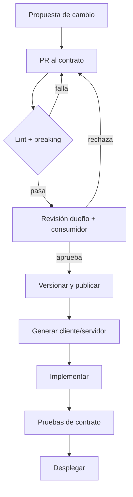

# Contrato Schema-First — Integración de Inventario (Stock)

Documento de diseño del contrato de integración entre **Descubre EC (Atracciones)** y el
**servicio de Inventario de Booking**, aplicando *schema-first*: el esquema se define, revisa
y versiona **antes** de escribir el código del cliente o del servidor.

Este documento es la plantilla del método para el resto de procesos del sistema
(Reservas, Pagos, Facturación, Notificaciones). El caso concreto que se diseña aquí es el
proceso **Inventario / Stock**, que es el único que cruza la frontera con Booking por gRPC.

---

## 0. Ficha del contrato

| Campo | Valor |
|---|---|
| Dominio | Inventario / Stock (cupos por turno) |
| Dueño del contrato | Equipo de Booking (servidor `InventoryStockService`) |
| Consumidor | Descubre EC — proceso de Inventario/Stock |
| Interfaces | gRPC (`inventory.proto`), eventos (`atracciones.stock.actualizado`), REST de lectura (`/atracciones/{id}/disponibilidad`) |
| Versión actual | `inventory` sin versión de paquete (se propone `v1`) |
| Estado | Diseño; requiere acuerdo con el equipo dueño |
| Fuente de verdad | Este documento + `backend/contracts/inventory.proto` |
| Archivos relacionados | `backend/contracts/atracciones-asyncapi.yaml`, `backend/contracts/atracciones-openapi-v2.yaml`, `backend/src/modules/atracciones/stock-sync.service.ts` |

---

## 1. Qué significa *schema-first* en este sistema

**El contrato es el artefacto de diseño de mayor jerarquía.** El código se genera o se valida
contra él; no al revés.

Principios que se aplican:

1. **Contrato antes que implementación.** Ningún cambio de comportamiento se acepta sin su
   cambio de esquema revisado y versionado.
2. **Una sola fuente de verdad por dato.** Cada campo se define una vez y los demás contratos
   lo referencian con la misma semántica (ver §8).
3. **Compatibilidad verificada por máquina.** `buf breaking` (gRPC), `spectral` (OpenAPI) y
   la validación de AsyncAPI corren en CI y bloquean el merge.
4. **Clientes y servidores generados o validados.** El cliente no se escribe "a mano contra la
   documentación": se genera desde el `.proto` o se valida contra el JSON Schema del evento.
5. **Versionado explícito.** Un cambio incompatible no se "arregla" en silencio: crea una
   versión nueva y convive con la anterior durante la transición.

Lo que **no** es schema-first: escribir el `.proto` al final para "documentar lo que quedó",
o publicar contratos que el CI no valida.

---

## 2. Alcance y contextos

### 2.1 Proceso dentro del sistema

| Proceso | Servicio dueño | Rol en este contrato |
|---|---|---|
| Catálogo | `Productos` | Define `item_id`, horarios y capacidad (`total_units`). |
| **Inventario / Stock** | `Stock` | **Dueño de la verdad** de los cupos. Publica snapshots y eventos. |
| Reservas | `Reservas` | Consume cupos; dispara `VENTA`, `CANCELACION`, `CHECKIN`. |
| Observabilidad | `Observabilidad` | Registra `ops.sync_stock` y reintentos. |
| Booking (externo) | Equipo Booking | **Réplica** de los cupos; expone `InventoryStockService`. |

### 2.2 Frontera

```mermaid
flowchart LR
  P[Productos] -->|horario / capacidad| S[Stock]
  R[Reservas] -->|VENTA / CANCELACION| S
  S -->|PushStockUpdate (gRPC)| B[Booking: InventoryStockService]
  S -->|atracciones.stock.actualizado| E[(Event Bus)]
  B -.->|GetStock (propuesto)| S
  O[Observabilidad] --- S
```

**Regla de oro:** Descubre EC es la fuente de verdad del cupo; Booking mantiene una réplica.
Por eso el contrato principal es un **snapshot absoluto**, no un delta.

### 2.3 Fuera de alcance

- Precio, moneda y facturación (pertenecen a `Productos`, `Pagos` y `Facturación`).
- Datos personales del titular (los eventos de stock no llevan PII).
- Lógica interna de reintentos (`ops.sync_stock`): se documenta en el diseño de
  Observabilidad, no en el contrato público.

---

## 3. Fuente de verdad por interfaz

| Interfaz | Archivo canónico | Formato | Dueño | Consumidor |
|---|---|---|---|---|
| gRPC de escritura/lectura | `contracts/inventory.proto` | Protobuf 3 | Booking | Descubre EC |
| Eventos de dominio | `contracts/atracciones-asyncapi.yaml` | AsyncAPI + JSON Schema | Descubre EC | Booking, notificaciones, analítica |
| REST de lectura | `contracts/atracciones-openapi-v2.yaml` | OpenAPI 3.1 | Descubre EC | Booking, web |
| Modelo interno | `database/01_esquema.sql` | SQL | Stock | Nadie fuera del servicio |

**Ningún consumidor lee la base de datos de otro proceso.** El modelo interno no es contrato.

---

## 4. Modelo canónico

### 4.1 Identificadores

| Concepto | Campo canónico | Formato | Regla |
|---|---|---|---|
| Tienda / nodo | `service_id` | string | Asignado por Booking; inmutable. |
| Producto | `item_id` | string (`atr_uuid`) | UUID de la atracción. |
| Turno | `slot_id` | `slot-YYYYMMDD-HHMM` | **Clave canónica**. Si viene, prevalece sobre `date` + `time_slot`. |
| Evento | `event_id` | UUID v4 | Idempotencia de eventos. |
| Envío lógico | `idempotency_key` | UUID v4 | Idempotencia de comandos. |

`date` y `time_slot` se conservan por compatibilidad, pero **la clave del turno es `slot_id`**.

### 4.2 Tiempo

| Campo | Tipo | Semántica |
|---|---|---|
| `date` | `YYYY-MM-DD` | Fecha local del turno. |
| `time_24h` | `HH:mm` | Hora canónica local (24 h). |
| `time_slot` | string | Representación humana acordada con Booking (hoy `"10:30 a.m."`). Solo presentación. |
| `timezone` | IANA | `America/Guayaquil` mientras no se acuerde otra. |
| `timestamp` | epoch ms UTC | Hora del **evento**, no la del envío. |
| `occurred_at` | ISO 8601 UTC | En eventos, equivalente legible de `timestamp`. |

Regla: ningún campo de hora se interpreta sin `timezone`. El formato de 12 h es **solo de
presentación**; los cálculos usan `time_24h`.

### 4.3 Cupos

| Campo | Tipo | Invariante |
|---|---|---|
| `total_units` | int32 | Capacidad del turno. `>= 0`. |
| `available_units` | int32 | Cupos libres. `0 <= available_units <= total_units`. |
| `delta` | int32 | Solo en eventos; `available_units_nuevo = anterior + delta`. |

- `available_units` **no** incluye retenciones pendientes: ya están descontadas.
- `revision` es monótona por `slot_id`. Dos escrituras con la misma `revision` son el mismo
  estado; gana la de mayor `revision`, nunca la de mayor reloj.
- La fuente de verdad aplica `SELECT ... FOR UPDATE` al reservar (sin sobreventa).

### 4.4 Errores

Un solo enum, compartido por gRPC y por el `code` de los eventos/ACK:

| `StockErrorCode` | gRPC status | ¿Reintentar? |
|---|---|---|
| `INVALID_ARGUMENT` | `INVALID_ARGUMENT` | No |
| `UNAUTHENTICATED` | `UNAUTHENTICATED` | No (renovar credencial) |
| `PERMISSION_DENIED` | `PERMISSION_DENIED` | No |
| `NOT_FOUND` | `NOT_FOUND` | No |
| `STALE_REVISION` | `FAILED_PRECONDITION` | No (ya hay un estado más nuevo) |
| `CONFLICT` | `ABORTED` | Sí, con nueva `revision` |
| `RATE_LIMITED` | `RESOURCE_EXHAUSTED` | Sí, con espera |
| `UNAVAILABLE` | `UNAVAILABLE` | Sí, con espera creciente |
| `INTERNAL` | `INTERNAL` | Sí, limitado |

El `message` es para humanos y logs; **nunca** se parsea. La decisión se toma con `code` y
`retryable`.

### 4.5 Idempotencia y orden

| Camino | Mecanismo |
|---|---|
| `PushStockUpdate` | `idempotency_key` + `revision` por `slot_id`. |
| Eventos | `event_id` (UUID) + `sequence` monótona por `slot_id`. |
| Stream | `sequence` por evento para detectar huecos; `StreamSummary.last_sequence` al cerrar. |

---

## 5. Contrato gRPC `inventory.v1`

> Cambio aditivo sobre el proto actual: campos 1–6 y la firma de `StreamInventoryChanges` se
> conservan. `package inventory` se mantiene para no romper al cliente actual; el sufijo `v1`
> se formaliza en el nombre del servicio/documentación y en el directorio de contratos.

```protobuf
syntax = "proto3";
package inventory;

// Contrato de inventario entre Descubre EC y Booking.
// El dueño es Booking; Descubre EC es el consumidor.
// Reglas: campos nuevos se agregan al final; nunca se reutiliza un número.

service InventoryStockService {
  // Snapshot absoluto de cupos de un turno. Idempotente por (slot_id, revision).
  rpc PushStockUpdate (StockUpdateMessage) returns (StockUpdateAck);

  // Envío por lotes de cambios. Requiere sequence; el resumen llega al cerrar.
  rpc StreamInventoryChanges (stream StockChangeEvent) returns (StreamSummary);

  // Lectura para reconciliación. Si no está implementado, responde UNIMPLEMENTED.
  rpc GetStock (GetStockRequest) returns (StockSnapshot);
  rpc GetStockBatch (GetStockBatchRequest) returns (GetStockBatchResponse);
}

enum StockErrorCode {
  STOCK_ERROR_CODE_UNSPECIFIED = 0;
  OK = 1;
  INVALID_ARGUMENT = 2;
  UNAUTHENTICATED = 3;
  PERMISSION_DENIED = 4;
  NOT_FOUND = 5;
  STALE_REVISION = 6;
  CONFLICT = 7;
  RATE_LIMITED = 8;
  UNAVAILABLE = 9;
  INTERNAL = 10;
}

message StockUpdateMessage {
  string service_id = 1;        // tienda dueña del cupo
  string item_id = 2;           // atr_uuid
  string date = 3;              // YYYY-MM-DD (compatibilidad)
  string time_slot = 4;         // presentación acordada, hoy "10:30 a.m."
  int32 available_units = 5;    // cupos libres (retenciones ya descontadas)
  int64 timestamp = 6;          // epoch ms UTC, hora del evento
  string slot_id = 7;           // clave canónica; prevalece sobre date+time_slot
  int64 revision = 8;           // versión monótona por slot (LWW)
  int32 total_units = 9;        // capacidad del turno
  string timezone = 10;         // IANA, p. ej. America/Guayaquil
  string idempotency_key = 11;  // UUID v4 del envío lógico
  string time_24h = 12;         // HH:mm canónico
}

message StockUpdateAck {
  bool success = 1;
  string message = 2;           // solo para humanos/logs
  int64 processed_at = 3;       // epoch ms UTC
  StockErrorCode code = 4;
  bool retryable = 5;
  string slot_id = 6;
  int64 revision = 7;           // revisión aceptada; menor que la enviada = STALE_REVISION
}

message StockChangeEvent {
  string event_id = 1;          // UUID v4
  string service_id = 2;
  string item_id = 3;
  string date = 4;
  string time_slot = 5;
  int32 delta = 6;              // cambio neto (+1, -2)
  int64 timestamp = 7;
  string slot_id = 8;
  int64 sequence = 9;           // orden monótono por slot
  int64 revision = 10;
}

message StreamSummary {
  int32 total_events_processed = 1;
  bool is_synchronized = 2;
  string last_sync_hash = 3;
  int64 last_sequence = 4;
  repeated StreamError errors = 5;
}

message StreamError {
  string event_id = 1;
  StockErrorCode code = 2;
  string message = 3;
}

message GetStockRequest {
  string service_id = 1;
  string slot_id = 2;           // o la terna item_id + date + time_slot
  string item_id = 3;
  string date = 4;
  string time_slot = 5;
}

message GetStockBatchRequest {
  string service_id = 1;
  repeated string item_ids = 2;
  string date_from = 3;         // YYYY-MM-DD
  string date_to = 4;           // YYYY-MM-DD
}

message GetStockBatchResponse {
  repeated StockSnapshot slots = 1;
}

message StockSnapshot {
  string slot_id = 1;
  string item_id = 2;
  string date = 3;
  string time_slot = 4;
  string timezone = 5;
  int32 total_units = 6;
  int32 available_units = 7;
  int64 revision = 8;
  int64 updated_at = 9;         // epoch ms UTC
}
```

### 5.1 Reglas de evolución del `.proto`

| Cambio | ¿Rompe? | Acción |
|---|:-:|---|
| Agregar campo/mensaje/RPC | No | Versión menor. |
| Agregar valor a un enum | No | Versión menor; el `0` sigue siendo `UNSPECIFIED`. |
| Renombrar campo (mismo número) | No binario, sí para JSON | Versión menor + alias documentado. |
| Cambiar tipo o número de campo | Sí | `v2`. |
| Quitar campo | Sí | `reserved` + `v2`. |
| Cambiar *streaming* de una RPC | Sí | `v2`. |
| Cambiar semántica de `time_slot` | Sí | `v2`. |

---

## 6. Contrato de eventos `atracciones.stock.actualizado`

Sobre CloudEvents/outbox ya existente. Se agregan los campos canónicos.

```yaml
channel: atracciones.stock.actualizado
envelope:
  specversion: "1.0"
  id: "<uuid>"                 # event_id
  source: "/api/v2/atracciones"
  type: "STOCK_ACTUALIZADO"
  time: "<ISO-8601 UTC>"
  sequence_number: 1532        # orden por slot
  correlation_id: "<uuid>"
data:
  slot_id: "slot-20261025-1030"
  attraction_id: "atr-...-uuid"
  date: "2026-10-25"
  time_24h: "10:30"
  time: "10:30 a.m."           # presentación
  timezone: "America/Guayaquil"
  total_units: 20
  available_units: 17
  revision: 42
  reason: "VENTA"              # VENTA | CANCELACION | CHECKIN | AFORO
```

Reglas:

- `available_units` es el **valor absoluto**; `reason` explica el motivo, no se usa para
  reconstruir el estado.
- El consumidor es idempotente por `id` y descarta `sequence`/`revision` menores.
- Si un evento llega sin `slot_id`, el consumidor usa `attraction_id + date + time_24h`.

---

## 7. Contrato REST de lectura

El turno se expone con el mismo modelo canónico en
`GET /api/v2/atracciones/{id}/disponibilidad?date=YYYY-MM-DD`:

```json
{
  "fecha": "2026-10-25",
  "time_slots": [
    {
      "slot_id": "slot-20261025-1030",
      "time": "10:30 a.m.",
      "time_24h": "10:30",
      "timezone": "America/Guayaquil",
      "capacidad": 20,
      "disponibles": 17,
      "estado": "DISPONIBLE",
      "revision": 42
    }
  ]
}
```

`estado`: `AGOTADO` (`disponibles = 0`), `ULTIMOS_CUPOS` (`<= 3`) o `DISPONIBLE`.

---

## 8. Matriz de correspondencia entre contratos

Un mismo concepto, el mismo nombre y la misma semántica en las tres interfaces:

| Concepto | gRPC | Evento | REST |
|---|---|---|---|
| Turno | `slot_id` | `data.slot_id` | `slot_id` |
| Producto | `item_id` | `data.attraction_id` | `id` (ruta) |
| Fecha | `date` | `data.date` | `fecha` |
| Hora canónica | `time_24h` | `data.time_24h` | `time_24h` |
| Hora de presentación | `time_slot` | `data.time` | `time` |
| Zona horaria | `timezone` | `data.timezone` | `timezone` |
| Capacidad | `total_units` | `data.total_units` | `capacidad` |
| Disponibles | `available_units` | `data.available_units` | `disponibles` |
| Versión | `revision` | `data.revision` | `revision` |
| Motivo | — | `data.reason` | — |

**Regla:** si un concepto no está en esta tabla, no se agrega a ningún contrato sin actualizarla.

---

## 9. Flujo de trabajo schema-first



Pasos concretos:

1. **Propuesta.** Se abre un PR que solo toca `backend/contracts/` (nunca código de negocio).
2. **Validación automática.** `buf lint`, `buf breaking` contra `main`, `spectral lint`,
   validación AsyncAPI con Ajv.
3. **Revisión humana.** El dueño del contrato aprueba semántica; el consumidor aprueba que
   puede implementarlo.
4. **Publicación.** El contrato se expone en `GET /api/v1/contracts/{nombre}` (ya existe).
5. **Generación.** El cliente gRPC y los tipos de evento se generan; no se editan a mano.
6. **Implementación.** El servidor y el cliente se ajustan al esquema; cualquier diferencia
   es un bug del código, no del contrato.
7. **Pruebas de contrato.** Ejemplos válidos e inválidos por campo, y un servidor simulado
   (ya existe en `test/e2e/booking-v2.e2e-spec.ts`).

---

## 10. Puertas de calidad en CI

| Puerta | Herramienta | Falla si |
|---|---|---|
| Estilo del proto | `buf lint` | Nombres, enums o paquetes no siguen la guía. |
| Compatibilidad | `buf breaking --against main` | Se rompe un consumidor. |
| OpenAPI | `spectral lint` | El esquema no cumple las reglas. |
| Eventos | `@asyncapi/parser` + Ajv | Un ejemplo no valida contra el esquema. |
| Código generado | `buf generate` + `git diff --exit-code` | El código generado no está actualizado. |
| Contrato REST | Schemathesis / Dredd | Una operación no responde según el esquema. |
| Consumidor | Pact | El productor quitó algo que el consumidor usa. |
| Revisión | CODEOWNERS | Cambia el contrato sin aprobación del dueño. |

---

## 11. Versionado y gobernanza

- **SemVer del contrato:** `MAYOR` = cambio incompatible; `MENOR` = aditivo; `PATCH` =
  aclaraciones sin cambio de esquema.
- **Paquete Protobuf:** `inventory` hoy; al primer cambio incompatible se crea `inventory.v1`
  (o `v2`) y ambos conviven.
- **Deprecación:** un campo o RPC se marca `deprecated = true`, se documenta la fecha de
  retiro y se mantiene al menos **6 meses** (igual que la política REST ya acordada).
- **Dueño:** Booking aprueba el `.proto`; Descubre EC aprueba los eventos y el REST.
- **Registro:** `GET /api/v1/contracts` es el catálogo público; este documento es la
  justificación de cada decisión.

---

## 12. Seguridad y datos

- **Transporte:** mTLS en red privada; TLS en dominio público. El proto no lleva credenciales.
- **Autorización:** `service_id` se valida contra el certificado/token; un nodo no puede
  escribir el inventario de otro.
- **Metadatos:** `x-correlation-id` en gRPC (ya se envía desde
  `stock-sync.service.ts:202`) y `correlation_id` en eventos.
- **Datos:** el contrato de stock **no** incluye PII. Nada de secretos, tokens ni datos de
  tarjeta en mensajes o eventos.

---

## 13. Decisiones de diseño (ADR)

| ID | Decisión | Motivo |
|---|---|---|
| ADR-001 | El camino principal es `PushStockUpdate` con snapshot absoluto. | Idempotente y resistente a pérdida de eventos; Booking es réplica. |
| ADR-002 | Descubre EC es la fuente de verdad del cupo. | Ya lo es en `disponibilidad`; evita escrituras bidireccionales. |
| ADR-003 | `revision` monótona por `slot_id`, no `timestamp` del cliente. | Evita *clock skew* y hace el LWW determinista. |
| ADR-004 | `slot_id` es la clave canónica; `date` + `time_slot` quedan por compatibilidad. | Elimina ambigüedad de formato y zona horaria. |
| ADR-005 | `time_slot` externo sigue en 12 h; el cálculo usa `time_24h`. | No romper a Booking; el formato es solo presentación. |
| ADR-006 | `GetStock`/`GetStockBatch` son aditivos y opcionales. | Permiten reconciliar sin cambiar la escritura; si no existen, `UNIMPLEMENTED`. |
| ADR-007 | El stream no es el camino de escritura principal. | Client-streaming sin ACK por evento ni replay no garantiza entrega. |

---

## 14. Preguntas abiertas con el equipo dueño

| # | Pregunta | Impacto |
|:-:|---|---|
| 1 | ¿Cómo se autentica el cliente (mTLS, JWT, API key)? | Sin esto no hay contrato operable. |
| 2 | ¿`available_units` descuenta retenciones? | Cambia el cálculo y la reconciliación. |
| 3 | ¿Se permite sobreventa? | Define la validación del servidor. |
| 4 | ¿`revision` la genera el servidor o el cliente? | Define quién resuelve conflictos. |
| 5 | ¿`GetStock` leerá la réplica o la fuente? | Define el valor de la reconciliación. |
| 6 | ¿El stream es una conexión larga o un lote? | Cambia el diseño del cliente. |
| 7 | ¿Cuál es el algoritmo de `last_sync_hash`? | Sin él, `is_synchronized` no es verificable. |
| 8 | ¿Límites de tasa, tamaño de mensaje y *deadlines*? | Afecta reintentos y lotes. |
| 9 | ¿Zona horaria oficial de `date` + `time_slot`? | Afecta el día del turno. |
| 10 | ¿Política de deprecación y ventana de convivencia? | Afecta el plan de versiones. |

---

## 15. Criterios de aceptación

- [ ] El `.proto` pasa `buf lint` y `buf breaking` contra la versión publicada.
- [ ] Cada campo de §4 tiene tipo, rango, unidad y semántica documentados.
- [ ] La matriz de §8 está completa: no hay concepto sin equivalente en las tres interfaces.
- [ ] El cliente no decide éxito con `ack == null`; usa `code` y `retryable`.
- [ ] `revision` viaja en push, ACK, evento y REST.
- [ ] Existe reconciliación periódica usando `GetStockBatch` (o *fallback* si responde
      `UNIMPLEMENTED`).
- [ ] Los eventos validan contra AsyncAPI y son idempotentes por `event_id`.
- [ ] CI bloquea cambios incompatibles sin aprobación del dueño.
- [ ] El contrato se publica en `GET /api/v1/contracts/inventory.proto`.

---

## 16. Ejemplo de uso

```bash
grpcurl -plaintext \
  -H 'x-correlation-id: cid-prueba-001' \
  -d '{
    "service_id": "atracciones-dilan",
    "item_id": "atr-123e4567-e89b-12d3-a456-426614174000",
    "slot_id": "slot-20261025-1030",
    "date": "2026-10-25",
    "time_slot": "10:30 a.m.",
    "time_24h": "10:30",
    "timezone": "America/Guayaquil",
    "available_units": 17,
    "total_units": 20,
    "revision": 42,
    "idempotency_key": "5f0c2b1e-8a4d-4c7e-9b2a-1d3f5e7a9c0b",
    "timestamp": 1792900000000
  }' \
  localhost:50051 inventory.InventoryStockService/PushStockUpdate
```

Respuesta esperada:

```json
{
  "success": true,
  "message": "ok",
  "processedAt": "1792900000123",
  "code": "OK",
  "retryable": false,
  "slotId": "slot-20261025-1030",
  "revision": "42"
}
```
