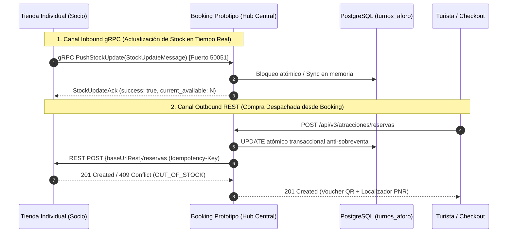

# Guía Técnica Oficial de Integración para Socios Externos — Vertical de Atracciones Turísticas

> **Plataforma Central:** Booking Prototipo (Marketplace Multimodal — Reto 2: RDA2)  
> **Institución:** Escuela Politécnica Nacional — Asignatura: Integración de Sistemas (6to Semestre)  
> **Líder Técnico Agregador:** Paúl Rosero  
> **Destinatarios:** Equipos desarrolladores de las 5 Tiendas Web Individuales de Atracciones Turísticas  
> **Versión Canónica del Contrato:** OpenAPI v3.0.0 & Protocol Buffers v3 (Semana 9)  
> **Fecha de Emisión:** Octubre 2026  

---

## 0. Marco Académico y Criterio Excluyente (Rúbrica RDA2)

> [!CAUTION]
> ### ⚠️ CONDICIÓN HABILITANTE OBLIGATORIA (CRITERIO EXCLUYENTE CE01)
> Conforme a la **Rúbrica Oficial del Reto 2 (RDA2)**:
> *"Todas las tiendas/sistemas individuales del curso se encuentran integradas funcionalmente con Booking Prototipo y operativas durante la demostración. Si la verificación es **NO**, la calificación final del curso/grupo es **0 puntos**."*
> 
> Esta guía proporciona todas las especificaciones contractuales, códigos de ejemplo, endpoints públicos y reglas de negocio para asegurar una integración fluida, resiliente y 100% aprobada.

---

## 1. Arquitectura de Integración Asimétrica (REST vs. gRPC)

Para cumplir con las Consideraciones RDA2 (§1, §3) y las Indicaciones de la Semana 9, la comunicación entre las tiendas individuales y **Booking Prototipo** opera bajo un modelo **asimétrico desacoplado**:



### Regla de Oro de la Asimetría:
1. **Tienda Socia ➔ Booking Prototipo (gRPC Inbound):** Cada vez que la tienda socia vende un boleto en su propia web, libera cupos o modifica horarios, transmite la novedad a Booking mediante **gRPC sobre HTTP/2** al puerto `50051`.
2. **Booking Prototipo ➔ Tienda Socia (REST Outbound):** Cuando un turista compra en Booking Prototipo, Booking descuenta el cupo atómicamente y despacha la reserva mediante una petición **REST HTTP/1.1** a la tienda del socio correspondiente (`POST ${baseUrlRest}/reservas`).

---

## 2. Insumos y Artefactos Oficiales de Entrega

Adjuntos en el repositorio del proyecto central, cada socio dispone de los siguientes archivos canónicos:

1. **Contrato OpenAPI v3 Canónico (REST):** [`contracts/atracciones-openapi-v3.yaml`](file:///c:/Users/ASUS/Documents/6to%20Semestre/Integración%20Sistemas/proyecto/plantilla%20inicial/contracts/atracciones-openapi-v3.yaml)
2. **Contrato Protocol Buffers v3 (gRPC):** [`src/proto/inventory.proto`](file:///c:/Users/ASUS/Documents/6to%20Semestre/Integración%20Sistemas/proyecto/plantilla%20inicial/src/proto/inventory.proto)
3. **JSON Schema Compilado (Validación Runtime AJV):** [`contracts/schemas/atracciones.schema.json`](file:///c:/Users/ASUS/Documents/6to%20Semestre/Integración%20Sistemas/proyecto/plantilla%20inicial/contracts/schemas/atracciones.schema.json)
4. **Contrato Consumer Pact Generado:** [`pacts/BookingPrototipoConsumer-AtraccionesPartnerProvider.json`](file:///c:/Users/ASUS/Documents/6to%20Semestre/Integración%20Sistemas/proyecto/plantilla%20inicial/pacts/BookingPrototipoConsumer-AtraccionesPartnerProvider.json)

---

## 3. URLs Oficiales de Conexión y Entornos

| Entorno | Protocolo | URL Base / Host | Descripción |
|---|---|---|---|
| **Producción (Render)** | **REST (HTTPS)** | `https://rda1-backend-integracion-sistemas.onrender.com/api/v3` | API Gateway Central de Booking desplegado en Internet. |
| **Producción (Render)** | **gRPC (HTTP/2)** | `rda1-backend-integracion-sistemas.onrender.com:50051` | Socket Inbound gRPC de ingesta continua de inventario. |
| **Local / Docker** | **REST (HTTP)** | `http://localhost:3000/api/v3` | Entorno local de desarrollo del Gateway NestJS. |
| **Local / Docker** | **gRPC (HTTP/2 h2c)** | `localhost:50051` | Socket local gRPC sin TLS para pruebas rápidas. |

> [!NOTE]
> Booking mantiene retrocompatibilidad tolerante (*Ley de Postel*): peticiones enviadas a `/api/v2` o `/api/v1` continúan operativas y son redirigidas internamente a la lógica canónica.

---

## 4. Especificación gRPC Inbound (Envío de Stock hacia Booking)

* **Servicio Protobuf:** `inventory.InventoryStockService`
* **Definición:** [`src/proto/inventory.proto`](file:///c:/Users/ASUS/Documents/6to%20Semestre/Integración%20Sistemas/proyecto/plantilla%20inicial/src/proto/inventory.proto)

### 4.1. RPC 1: `PushStockUpdate` (Obligatorio)
Debe invocarse ante cada evento de venta local, cancelación o recarga de aforo en la tienda socia:

```protobuf
message StockUpdateMessage {
  string service_id = 1;      // Código del socio (ej. "NODE_ATR_DILAN", "NODE_ATR_CRUCEROS_01")
  string item_id = 2;         // ID o slug de la atracción (ej. "PRhu4UBTWPBC")
  string date = 3;            // Fecha del turno (formato ISO YYYY-MM-DD, ej. "2026-10-25")
  string time_slot = 4;       // Franja horaria (ej. "10:30 a.m." o "10:30:00")
  int32 available_units = 5;  // Cupos vigentes netos disponibles (0 si está agotado)
  int64 timestamp = 6;        // Unix Epoch timestamp en milisegundos (Date.now())
  string slot_id = 7;         // Identificador canónico del turno (ej. "slot-20261025-1030")
}
```

**Respuesta Retornada por Booking:**
```protobuf
message StockUpdateAck {
  bool success = 1;           // true si el turno fue sincronizado e indexado exitosamente
  string message = 2;         // Detalle legible del procesamiento
  int64 processed_at = 3;     // Timestamp Epoch del procesamiento en Booking
  string error_code = 4;      // "OK", "STALE_TIMESTAMP_IGNORED", "ITEM_NOT_FOUND", "INVALID_SLOT"
  int32 current_available = 5;// Cupos confirmados vigentes en Booking
}
```

> [!WARNING]
> **Protección contra Eventos Desordenados (Regla Monotónica de Timestamps):** Si una tienda socia transmite un paquete con un `timestamp` inferior al último procesado para ese turno, Booking descartará el evento de forma segura retornando `success: false` con `error_code: "STALE_TIMESTAMP_IGNORED"`.

### 4.2. RPC 2: `StreamInventoryChanges` (Streaming de Ráfagas)
Permite enviar deltas numéricos (`+1` cupo liberado, `-2` cupos vendidos) a través de un canal continuo de streaming HTTP/2 multiplexado para alta concurrencia.

### 4.3. RPC 3: `GetSlotAvailability` (Consulta de Sincronización)
Permite a la tienda socia consultar el estado exacto que Booking tiene registrado para un turno (`DISPONIBLE`, `ULTIMOS_CUPOS`, `AGOTADO`) antes de lanzar promociones comerciales.

---

## 5. Especificación REST Outbound (Recepción de Compras desde Booking)

Cuando un turista reserva y paga un paquete en Booking, nuestro agregador despacha la reserva mediante una llamada REST a la tienda del socio dueño de esa atracción:

* **Método HTTP:** `POST`
* **Ruta en la Tienda del Socio:** `${baseUrlRest}/reservas`
* **Cabeceras Obligatorias:**
  * `Content-Type: application/json`
  * `Idempotency-Key: <UUID único de la orden>`
  * `X-Correlation-Id: <UUID de trazabilidad distribuida>`

### 5.1. Payload Canónico Enviado por Booking

```json
{
  "attraction_id": "PRhu4UBTWPBC",
  "date": "2026-10-25",
  "time": "10:30 a.m.",
  "slot_id": "slot-20261025-1030",
  "adult_count": 2,
  "child_count": 1,
  "senior_count": 0,
  "infant_count": 0,
  "total_tickets": 3,
  "customer": {
    "name": "María José Flores",
    "email": "turista@epn.edu.ec",
    "phone": "+593991234567",
    "document_id": "1724589633"
  },
  "special_requirements": "Requiere audio-guía en inglés",
  "booking_reservation_id": "RES-ATR-A1B2C3"
}
```

### 5.2. Respuestas que la Tienda Socia DEBE Retornar

#### A. Compra Exitosa (`201 Created`):
```json
{
  "success": true,
  "reservation_id": "f47ac10b-58cc-4372-a567-0e02b2c3d479",
  "reservation_code": "DEC-7F3K9Q",
  "status": "CONFIRMED",
  "message": "Reserva confirmada exitosamente en la tienda individual."
}
```
> [!NOTE]
> **Formato de Identificadores:** `reservation_id` debe ser un UUID v4 canónico (coincidiendo con `res_uuid` de su tabla `reserva`). Si desean enviar un localizador corto para el cliente, pueden incluir `reservation_code` (ej. `"DEC-7F3K9Q"`).

#### B. Sin Cupos Disponibles (`409 Conflict`):
Si en el milisegundo anterior la tienda socia agotó sus cupos locales, debe responder **estrictamente con `409 Conflict` y `code: "OUT_OF_STOCK"`** (formato Problem Details RFC 7807):
```json
{
  "type": "https://booking.epn.edu.ec/errors/sin-cupos",
  "title": "Cupos Agotados para el Turno",
  "status": 409,
  "detail": "No existen cupos disponibles para el turno solicitado (10:30 a.m.).",
  "code": "OUT_OF_STOCK"
}
```
> [!IMPORTANT]
> **Trigger Oficial de Sagas:** Esta respuesta `409 Conflict` con `code: OUT_OF_STOCK` es el **único detonador oficial** para que el orquestador de Booking ejecute la transacción compensatoria LIFO (reversar cobros con tarjeta y cancelar vuelos/hoteles asociados).

---

## 6. Regla Canónica de Precedencia en el Checkout (`slot_id` vs `time`)

Para resolver la ambigüedad de redundancia detectada por los agentes de los compañeros:

1. **`slot_id` es la clave primaria de aforo:** Un identificador como `slot-20261025-1030` codifica de forma inmutable la franja `2026-10-25 10:30:00`.
2. **Validación de Integridad:** Si en la petición se envía `slot_id: "slot-20261025-1030"` pero en el campo `time` se envía `"14:00:00"` o en `date` se envía `"2026-10-26"`, Booking rechazará la transacción inmediatamente con **`400 Bad Request`**:
   ```json
   {
     "type": "https://booking.epn.edu.ec/errors/slot-mismatch",
     "title": "Inconsistencia de Franja Horaria (Slot Time Mismatch)",
     "status": 400,
     "detail": "El slot_id 'slot-20261025-1030' codifica la franja de las 10:30, pero la petición envió 'time': '14:00:00'.",
     "code": "SLOT_TIME_MISMATCH"
   }
   ```

---

## 7. Mandatos Específicos de Cátedra RDA2

### 7.1. Check-in Presencial en Punto de Encuentro (Consideraciones RDA2 §4)
Toda atracción turística debe soportar la validación física del turista antes de iniciar el tour:
* **Endpoint:** `POST /api/v3/atracciones/reservas/{id}/checkin`
* **Payload:**
  ```json
  {
    "documento_identidad": "1724589633",
    "guia_asignado": "Carlos Villacís (Licencia MINTUR-441)"
  }
  ```
* **Respuesta (`200 OK`):** Retorna `estado: "CHECKED_IN"`, fecha/hora de validación presencial y confirmación del voucher QR.

### 7.2. Cuestionario B2B para Promociones y Combos de Paquetes (Consideraciones RDA2 §9)
La cátedra exige que en el contrato se formalice una sola vez si la tienda acepta promociones y su descuento máximo autorizado:
* **Consulta:** `GET /api/v3/atracciones/promociones/contrato`
* **Actualización:** `PUT /api/v3/atracciones/promociones/contrato`
* **Campos:**
  * `permite_promociones` (boolean): `true` o `false`.
  * `porcentaje_descuento_maximo` (number): Ej. `15.0` (15% de descuento máximo para paquetes).
  * `destinos_habilitados` (array): `["Quito", "Baños", "Galápagos"]`.

### 7.3. Taxonomía de Categorías con Banderas de Inclusión (Consideraciones RDA2 §6)
El árbol de categorías debe indicar claramente los servicios incluidos:
* **Endpoint:** `GET /api/v3/atracciones/categorias/arbol`
* **Banderas Requeridas:**
  * `includes_food` (`incluye_comida`): boolean.
  * `includes_transport` (`incluye_transporte`): boolean.
  * `includes_guide` (`incluye_guia`): boolean.

---

## 8. Pasos para Integrarse en Menos de 5 Minutos

1. **Compilar el archivo `.proto`:** Generar los stubs de cliente gRPC en el lenguaje de tu tienda (Node.js, Python, Java, Go) usando [`src/proto/inventory.proto`](file:///c:/Users/ASUS/Documents/6to%20Semestre/Integración%20Sistemas/proyecto/plantilla%20inicial/src/proto/inventory.proto).
2. **Implementar el cliente gRPC:** Enviar un `PushStockUpdate` inicial con los cupos de tus atracciones al host `rda1-backend-integracion-sistemas.onrender.com:50051`.
3. **Implementar el endpoint receptor REST:** En el backend de tu tienda, crea la ruta `POST /reservas` para recibir compras de Booking y retornar `201 Created` o `409 Conflict`.
4. **Registrar tu tienda en el Panel de Booking:**
   * Entra a `https://rda1-api.onrender.com/admin/dashboard` ➔ pestaña **Nodos**.
   * Clic en **"Registrar Proveedor"**.
   * Ingresa tu código de nodo (ej. `NODE_ATR_CRUCEROS_01`), tu URL REST pública y tu endpoint gRPC.
   * El semáforo pasará automáticamente a 🟢 **Healthy** y tu tienda quedará 100% integrada al ecosistema evaluable del curso.
